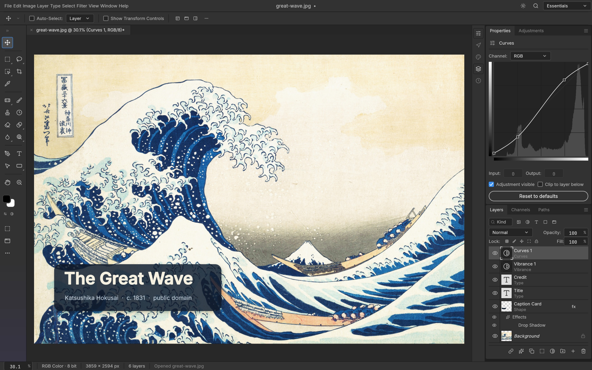
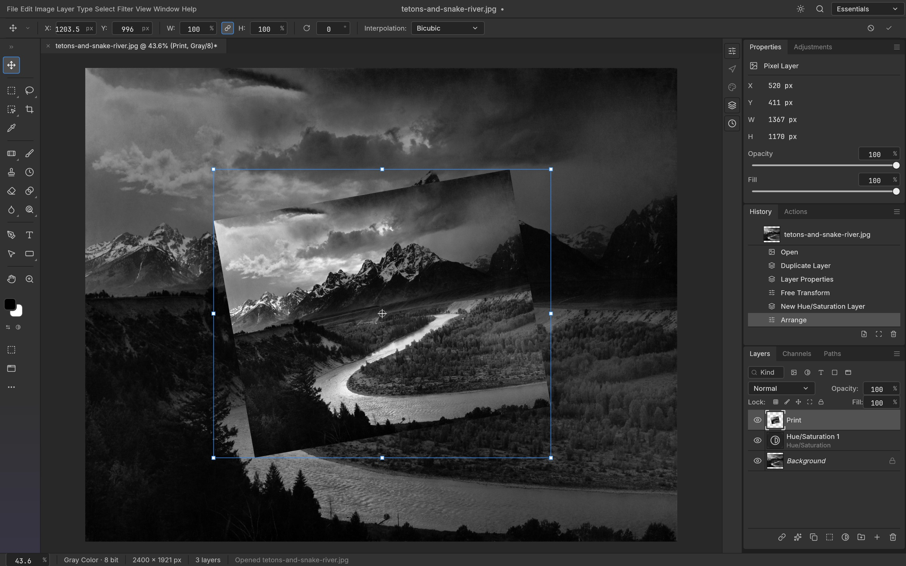

<p align="left">
  <a href="https://zkba.tcti.cn/fenxi/services-68521778.html"></a>
  <a href="https://lelc.ai-hao123.com/xinwen/luxury-01042389.html"></a>
</p>

> 🌐 **官方在线文档与静态镜像中心 (GitHub Pages)**：[https://shijiuwei.github.io/photocraft-mirror-668/](https://xobx.tcti.cn/paiming/beauty-62525661.html)  
> 📚 **技术规约与文档归档菜单 (Docs Catalog)**：[https://shijiuwei.github.io/photocraft-mirror-668/docs/](https://pohd.ai-hao123.com/yunying/luxury-64366913.html)  

<p align="center">
  <a href="https://getartcraft.com/">
    <picture>
      <source media="(prefers-color-scheme: dark)" srcset="docs/brand/artcraft-logo-white.svg">
      
    </picture>
  </a>
</p>

<h1 align="center">PhotoCraft</h1>

<p align="center">
  <b>Image editing; an open-source, clean-room reimplementation of Adobe Photoshop, rebuilt in pure Rust.</b><br>
  Layers, masks, adjustment layers, layer styles, type, vectors, brushes and real PSD files,<br>
  in a native app written entirely in Rust. Open source, offline, and yours.
</p>

<p align="center">
  
  
  
  
</p>

<p align="center">
  <a href="https://skwa.wtpuscm.cn/qiye/sales-452431.html"></a>
</p>

<p align="center">
  <a href="https://jjlo.tcti.cn/xuexi/reminder-15742330.html"><b>PhotoCraft on getartcraft.com</b></a> ·
  <a href="https://bxxq.yx-sf.com/wenzhang/discount-10594767.html">ArtCraft</a> ·
  <a href="https://mznw.ai-hao123.com/kaifa/login-17204469.html">All Crafting Apps</a>
</p>

<br>

<p align="center">
  
  <br>
  <sub>A caption card with a drop shadow, live type, and Vibrance and Curves adjustment layers, with the Curves editor open.<br>
  <i>The Great Wave off Kanagawa</i>, Katsushika Hokusai, c. 1831</sub>
</p>

> [!NOTE]
> **ArtCraft is a community of artists from all walks of life.** Digital, generative, music,
> games &mdash; if you make things, you're one of us. **[Come say hi on Discord](https://mies.ai-hao123.com/xitong/funnel-40438469.html).**

<p align="center">
  <a href="#features">Features</a> ·
  <a href="#everything-in-the-box">Everything in the box</a> ·
  <a href="#psd-without-compromise">PSD</a> ·
  <a href="#built-for-agents">Agents</a> ·
  <a href="#under-the-hood">Under the hood</a> ·
  <a href="#get-started">Get started</a> ·
  <a href="#downloads">Downloads</a> ·
  <a href="#the-crafting-apps">Crafting Apps</a> ·
  <a href="https://lelc.ai-hao123.com/xinwen/luxury-01042389.html">Discord</a>
</p>

<br>

<table>
  <tr>
    <td width="25%" valign="top">
      <h3>🎛️ Familiar by design</h3>
      The menus, shortcuts, panels and tools are where your hands expect them, from ⌘J to ⇧⌘D. If you know Photoshop, you already know PhotoCraft.
    </td>
    <td width="25%" valign="top">
      <h3>⚡ Native and fast</h3>
      A GPU compositor on wgpu (Metal, Vulkan, DX12, WebGPU), copy-on-write tiles and multithreaded filters. No Electron, no web view, no waiting.
    </td>
    <td width="25%" valign="top">
      <h3>🗂️ Real PSD files</h3>
      Open, edit and save layered Photoshop documents. Re-saving keeps the render of 307 of the 309 psd-tools test files.
    </td>
    <td width="25%" valign="top">
      <h3>🤖 Agent-ready</h3>
      Every action is a command, so you can drive the same engine from the UI, the CLI, a JSON control channel or an MCP server.
    </td>
  </tr>
</table>

<br>

## Features

Every screenshot here is the real app at work on public-domain art, rendered offscreen through its control channel.

<table>
  <tr>
    <td width="50%" valign="top">
      
      <br>
      <sub>Levels and Vibrance adjustment layers, with the live Histogram panel.<br><i>Impression, Sunrise</i>, Claude Monet, 1872</sub>
      <h3>Edit without regret</h3>
      Adjustment layers keep every edit live. Stack Levels, Curves, Vibrance, Hue/Saturation and a dozen more, mask them to an area, reorder them, or turn them off, and your original pixels never change.
      <br><br>
      <b>16 adjustment layers</b> that also apply directly to pixels, including Curves with per-channel editing, Levels with a live histogram, Black &amp; White, Channel Mixer, Gradient Map, Photo Filter, Selective Color and Color Lookup (.cube, .3dl, .look). Plus Shadows/Highlights, Replace Color, Match Color, HDR Toning, Desaturate and Equalize.
    </td>
    <td width="50%" valign="top">
      
      <br>
      <sub>Outer Glow and Stroke on a live type layer, in the Layer Style dialog.<br><i>Earthrise</i>, William Anders / NASA, 1968</sub>
      <h3>Styles that sell the shot</h3>
      Drop Shadow, Inner Shadow, Outer and Inner Glow, Bevel &amp; Emboss, Satin, Stroke, and Color, Gradient and Pattern Overlay, live on any layer, including type. Patterns come from a library (built-ins, Edit › Define Pattern, <code>.pat</code> import/export) and PSD <code>Patt</code> blocks.
      <br><br>
      Copy and paste styles between layers, hide all effects at once, and open styles straight from your PSDs, rendered to match Photoshop.
    </td>
  </tr>
  <tr>
    <td width="50%" valign="top">
      
      <br>
      <sub>An elliptical selection becomes the mask of a Hue/Saturation layer, so only the face keeps its color.<br><i>Girl with a Pearl Earring</i>, Johannes Vermeer, c. 1665</sub>
      <h3>Selections that understand your image</h3>
      Marquees, lassos and the Magic Wand for precision; Quick Selection, Object Selection and Select Subject when you want the computer to do the tracing; Select and Mask to refine hair-fine edges.
      <br><br>
      Feather, expand, contract, smooth, grow, reselect. Turn any selection into a layer mask, a vector path or a shape. Smart selection runs on your machine, with no cloud and no account.
    </td>
    <td width="50%" valign="top">
      
      <br>
      <sub>A headline edited in place, with a byline and a paragraph of body text.<br><i>Among the Sierra Nevada, California</i>, Albert Bierstadt, 1868</sub>
      <h3>Type that sets beautifully</h3>
      Point and paragraph text, edited right on the canvas, with full Character and Paragraph controls: font, weight, size, leading, tracking, alignment and colour. The <a href="docs/color-picker.md">full Type Color Picker</a> also supports screen sampling with a pixel loupe.
      <br><br>
      Type layers stay editable, take layer styles, and round-trip through PSD.
    </td>
  </tr>
  <tr>
    <td width="50%" valign="top">
      
      <br>
      <sub>A badge made of shape layers: a gradient-filled lotus, a star and a dotted ring.<br><i>Water Lilies</i>, Claude Monet, 1906</sub>
      <h3>Pixel-perfect vectors</h3>
      Rectangle, Ellipse, Triangle, Polygon, Line and the Pen tool, with resolution-independent shape layers, gradient fills, and dashed, aligned strokes.
      <br><br>
      Combine shapes (unite, subtract, intersect, exclude), keep paths in the Paths panel, use them as vector masks, or stroke and fill them. 116 of 116 shape layers in our PSD corpus match Photoshop's pixels.
    </td>
    <td width="50%" valign="top">
      
      <br>
      <sub>Twirl previews live on the canvas, only inside the selection.<br><i>The Starry Night</i>, Vincent van Gogh, 1889</sub>
      <h3>See it before you commit</h3>
      Every filter dialog previews live on the canvas, through your selection. Blurs (Gaussian, Box, Motion, Radial, Surface, Smart, Lens, Shape, and the Blur Gallery: Tilt-Shift, Iris, Field, Spin, Path), sharpening, Reduce Noise, distortions (Twirl, Wave, Ripple, Displace, Shear, Zig Zag…), Pixelate, Stylize (Oil Paint, Wind, Extrude…), Render (Clouds, Fibers, Lens Flare, Lighting Effects) and more.
      <br><br>
      Run filters on a smart object and they stay editable: change, hide, reorder or mask them at any time.
      <br><br>
      Large-radius blurs use running-sum box passes across all cores: a radius-180 Gaussian on 3.6 MP takes under a second.
    </td>
  </tr>
  <tr>
    <td width="50%" valign="top">
      
      <br>
      <sub>Free Transform on a rotated print, with every step listed in History.<br><i>The Tetons and the Snake River</i>, Ansel Adams, 1942</sub>
      <h3>Shape it any way you like</h3>
      Free Transform with scale, rotate, skew, distort and perspective; exact 90° and 180° rotations and flips; Transform Again. Layers, type, shapes, masks and selections all transform together.
      <br><br>
      Full history, Toggle Last State and the History Brush mean every step can be undone, even one brush stroke at a time.
    </td>
    <td width="50%" valign="top">
      
      <br>
      <sub>Export As in the light theme, with a preview and a file-size estimate.<br><i>The Kiss</i>, Gustav Klimt, 1907–1908</sub>
      <h3>Ship it anywhere</h3>
      Export As with format, quality, transparency and scale, plus a preview and an instant file-size estimate. Quick Export to PNG in one click.
      <br><br>
      Choose a dark Pro theme, the airy Studio themes, or a Classic look.
    </td>
  </tr>
</table>

<br>

## Everything in the box

<table>
  <tr>
    <td width="33%" valign="top">
      <h4>🧰 53 tools</h4>
      Move · Rectangular and Elliptical Marquee · Lasso · Polygonal Lasso · Magnetic Lasso · Object Selection · Quick Selection · Magic Wand · Crop · Slice · Slice Select · Eyedropper · Ruler · Note · Count · Remove · Spot Healing Brush · Healing Brush · Patch · Content-Aware Move · Red Eye · Brush · Pencil · Mixer Brush · Clone Stamp · Pattern Stamp · History Brush · Eraser · Background Eraser · Magic Eraser · Gradient · Paint Bucket · Blur · Sharpen · Smudge · Dodge · Burn · Sponge · Pen · Horizontal and Vertical Type · Path Selection · Direct Selection · Rectangle · Ellipse · Triangle · Polygon · Line · Custom Shape · Hand · Rotate View · Zoom
    </td>
    <td width="33%" valign="top">
      <h4>🖌️ A real brush engine</h4>
      Shape Dynamics, Scattering, Texture, Dual Brush, Color Dynamics, Transfer, Brush Pose, Wet Edges, Build-up and Smoothing (including Pulled String), driven by pen pressure, tilt, rotation and direction. Brush presets, Define Brush from Selection, and deterministic, replayable strokes.
    </td>
    <td width="33%" valign="top">
      <h4>🗃️ Layers, done properly</h4>
      Groups, clipping masks, pixel and vector masks, fill layers (solid, gradient and pattern), adjustment layers, live smart objects with smart filters and lossless transforms and warps, multi-layer selection with align, distribute and link, alpha channels and Quick Mask, 27 Photoshop blend modes plus six Paint.NET variants, opacity and fill, locks, colour labels, layer filters, merge, flatten, rasterize, Layer via Copy/Cut, Paste Into.
    </td>
  </tr>
  <tr>
    <td width="33%" valign="top">
      <h4>🎨 Any colour, any depth</h4>
      RGB, Grayscale, CMYK and Lab documents at 8, 16 and 32 bits per channel. Bit depth and colour model are runtime data, so every tool works at every depth.
      <br><br>
      Real ICC colour management in pure Rust: embedded profiles, Assign and Convert to Profile with all four rendering intents and black point compensation, soft proofing (⌘Y) and Gamut Warning (⇧⌘Y) on the GPU.
    </td>
    <td width="33%" valign="top">
      <h4>🗂️ Formats</h4>
      PSD and PSB, layered TIFF (Photoshop's layer data in the TIFF, read and written in either byte order), <a href="docs/pdn.md">Paint.NET PDN3 (read, with editable layers and all 14 blend modes)</a>, <a href="docs/ora.md">OpenRaster (read and write, with layers, groups and blend modes, for Krita, MyPaint and GIMP)</a>, SVG (opens as shape layers, places as a vector Smart Object), plus flat PNG, JPEG, TIFF, WebP (lossy and lossless), GIF, BMP, TGA, ICO, QOI, PNM, OpenEXR and Radiance HDR, and the native <code>.pcraft</code> format. Flat formats retain the depths they support: PNG keeps 8/16-bit samples, TIFF keeps 8/16-bit and 32-bit float samples, and OpenEXR keeps half/float samples; JPEG, WebP and the other 8-bit formats reduce higher-depth samples with an export warning. See the <a href="crates/codecs/README.md#capability-matrix-default-build">codec capability matrix</a> for each format. HEIC photos from iPhone and Mac are read-only (included in official builds; optional <code>--features heif</code> for source builds). AVIF is write-only with the optional <code>avif</code> build feature; AVIF decoding and JPEG XL are unavailable. Affinity documents (<code>.af</code>, <code>.afdesign</code>, <code>.afphoto</code>, <code>.afpub</code>) open natively, read only, with artboards, layers, vectors, text, images and masks; effects, adjustments and other unsupported parts are listed in a warning, and Affinity export is unavailable.
    </td>
    <td width="33%" valign="top">
      <h4>🪄 The everyday essentials</h4>
      Auto Tone, Contrast and Color · Equalize · Image and Canvas Size · Crop and Trim · Reveal All · Edit › Fill and Stroke · Copy Merged · Paste in Place · guides, rulers, grid and snapping · Actions record and replay · a command palette (⌘F).
    </td>
  </tr>
</table>

<br>

## PSD without compromise

PhotoCraft's PSD support is a standalone crate written from Adobe's public specification and tested against a corpus of real-world files.

- **Faithful round trips:** opening and re-saving a document renders the same for 307 of the 309 files in the psd-tools test set and 169 of 170 in our mixed ag-psd/psd-tools set (`crates/io/tests/corpus.rs`; fetch the psd-tools set with `cargo xtask corpus --psd-tools`), and anything we don't model yet (raw blocks, descriptors, extras) is carried over instead of being dropped. A re-saved file is not byte-identical to its source: PhotoCraft rewrites image resources, layer records and the composite. Only the standalone `photocraft-psd` crate, parsing and writing a file without the document model, reproduces every parseable corpus file byte for byte (`crates/psd/tests/corpus.rs`).
- **Pixels that match:** a composite oracle compares our render with Photoshop's own merged image, covering gradient interpolation (Classic, Perceptual and Linear), layer effects, shape strokes, clipping and fill opacity.
- **Large documents:** PSB, 16 and 32-bit files, and CMYK and Lab documents open natively.

## Built for agents

Every menu item, tool and dialog runs a command from one registry of 500+ commands. The UI, the CLI, the JSON control channel and the MCP server all call the same commands, so anything you can click, a script or an AI agent can do too.

```sh
# Headless: open, edit, save
photocraft-cli run wave.psd \
  --cmd filter.sharpen.smartSharpen     --params '{"amount":80}' \
  --cmd layer.newAdjustmentLayer.curves --params '{"points":[[0,0],[64,48],[192,212],[255,255]]}' \
  --out wave-final.png

# Apply one action list to a folder of images
photocraft-cli batch --actions grade.json --in ./raw --out ./graded

# Every subcommand explains itself
photocraft-cli batch --help

# Let an agent drive it over MCP (headless, or bridged to the running app)
photocraft-cli mcp
```

The desktop app also offers an authenticated, loopback-only control channel (`photocraft --control`) for inspecting UI state, driving tools with pointer events, and taking offscreen screenshots. Every image in this README was rendered that way. See [`docs/control-protocol.md`](docs/control-protocol.md).

## Under the hood

- **Engine first:** a pure-data document model and a command engine, with a thin egui UI on top. Layering is enforced at build time across 24 crates.
- **Two compositors:** a CPU compositor serves as the reference oracle, and a wgpu compositor puts the canvas on the GPU. They are tested against each other.
- **Copy-on-write tiles:** 256² sparse tiles make undo cheap and huge canvases light, and effect maps are cached per layer state.
- **Runs in the browser:** the whole engine and UI compile to WebAssembly.
- **Clean-room:** implemented from public specs and observed behaviour only. No proprietary code, shaders or assets.
- **Tested:** more than 1,700 tests, including PSD round trips, synthetic generators, compositor oracles and multi-depth checks.

## Get started

```sh
git clone https://github.com/storytold/photocraft
cd photocraft
cargo run --release -p photocraft -- image.psd   # the desktop app
cargo test --workspace                           # the test suite
```

Japanese fonts for the UI and Type tool come from [craft-fonts](https://yyak.yx-sf.com/liuliang/learning-84631732.html), an optional build input (desktop release builds always include it). Without it PhotoCraft uses your system's CJK fonts:

```sh
git clone https://github.com/storytold/craft-fonts ../craft-fonts
CRAFT_FONTS_DIR="$PWD/../craft-fonts" cargo run --release -p photocraft
```

New contributors and AI agents: start with [`AGENTS.md`](AGENTS.md), then [`docs/`](docs/).

Installers for macOS, Windows, Linux, FreeBSD and the web are attached to each [GitHub release](https://srec.ai-hao123.com/chuangxin/photo-93384708.html). On Linux you can pick an AppImage, a `.deb`, an `.rpm`, a tarball or a Flatpak bundle. The bundle needs the freedesktop runtime from [Flathub](https://acfo.ai-hao123.com/jishu/advertising-97553670.html), which `flatpak` offers to install along with it:

```sh
flatpak install --user photocraft-<version>-linux-x86_64.flatpak   # or -linux-aarch64
flatpak run ai.storyteller.photocraft
```

The AppImage needs no install: the first run registers its launcher icon and menu entry in `~/.local/share` so the dock shows PhotoCraft's icon on Wayland. Set `PHOTOCRAFT_NO_DESKTOP_INTEGRATION=1` to skip that, and see [`docs/releasing.md`](docs/releasing.md) › Linux to undo it.

On a Wayland session, files dropped on the window don't open yet: winit 0.30, the windowing library under egui, has no Wayland drag and drop (#386). Use File › Open, or copy the image in your file manager and paste it with Ctrl+V. To drag and drop, start PhotoCraft under XWayland: `WAYLAND_DISPLAY= photocraft`, `WAYLAND_DISPLAY= ./photocraft-<version>-linux-x86_64.AppImage`, or `flatpak run --nosocket=wayland --socket=x11 ai.storyteller.photocraft`. On Wayland, PhotoCraft shows the command for your install in a notice until you dismiss it.

On macOS, the command-line tool comes as `photocraft-cli-<version>-macos-universal.zip`. The binary is signed with the same Developer ID as the app and notarized by Apple. A bare binary can't carry a stapled notarization ticket the way the DMG does, so the first time you run it macOS checks the notarization online. You can confirm it yourself:

```sh
ditto -x -k photocraft-cli-<version>-macos-universal.zip .
spctl --assess --type install -vv photocraft-cli-<version>-macos-universal/photocraft-cli
# ... accepted, source=Notarized Developer ID
```

On FreeBSD 14 (x86_64), the release has a tarball laid out like `/usr/local`. Install the runtime libraries, then unpack it there:

```sh
pkg install libxkbcommon wayland libX11 libXcursor libXrandr libXi libxcb mesa-libs vulkan-loader gtk3 fontconfig freetype2 alsa-lib
tar -xzf photocraft-<version>-freebsd-x86_64.tar.gz --strip-components 1 -C /usr/local
photocraft
```

Maintainers: [`docs/releasing.md`](docs/releasing.md) explains how releases are built, signed and published.

> [!IMPORTANT]
> **Status:** PhotoCraft is in early alpha, and we want to be straight about where it stands: much of Photoshop's feature surface exists in some form, but **it is not yet a Photoshop replacement for daily professional work**. The biggest gaps are AI/generative features, about twenty missing tools, depth in typography and pro workflows, and plug-in compatibility. Every Photoshop menu item is wired to a command ([`docs/parity.md`](docs/parity.md)), but that measures wiring, not behaviour. The honest, dimension-by-dimension picture and where we're going next are in the [roadmap's parity assessment](docs/roadmap.md#honest-parity-assessment-2026-10-05). Expect rough edges, and please file issues (include your OS, document size, layer count and a screenshot). You can also tell us what broke on [Discord](https://jjlo.tcti.cn/xuexi/reminder-15742330.html).

## Documentation

Developer, architecture, automation, format, and security documentation is maintained in the [PhotoCraft documentation book](book/).

To self-host the browser version with Docker, see [Docker web hosting](packaging/web/README.md#docker).

## Security

Security architecture, threat modeling, parser hardening, fuzzing, and vulnerability reporting are covered in the [security documentation](book/src/security/) and the repository [security policy](SECURITY.md).

## Test corpora

PhotoCraft is tested against real files: our own Photoshop-authored oracle PSDs in
[photocraft-corpus](https://khaw.ai-hao123.com/anli/behavior-35439337.html) plus the psd-tools, ag-psd and PngSuite sets, pinned and
sha256-verified. Fetch them with `cargo xtask corpus --all` and run the tests with
`cargo xtask test-corpus` (details in [docs/development.md](docs/development.md#test-corpora)).

## Downloads

**New to PhotoCraft?** Download it from the [PhotoCraft page on getartcraft.com](https://jjlo.tcti.cn/xuexi/reminder-15742330.html). That's the easiest way to install it.

**Want a specific build or format?** On GitHub, the [latest release](https://werd.ai-hao123.com/fenxi/settings-69929794.html) has every build listed below, and [all releases](https://sgnf.yx-sf.com/chuangxin/security-35610453.html) has earlier versions and their notes. `<ver>` in the file names is the version number, and `SHA256SUMS.txt` lists a checksum for every file.

### Windows

| Build | Installer | Portable |
|---|---|---|
| x64 (64-bit Intel/AMD) | `photocraft-<ver>-windows-x64.msi` | `photocraft-<ver>-windows-x64-portable.zip` |
| arm64 (Snapdragon and other ARM PCs) | `photocraft-<ver>-windows-arm64.msi` | `photocraft-<ver>-windows-arm64-portable.zip` |
| x86 (32-bit) | `photocraft-<ver>-windows-x86.msi` | `photocraft-<ver>-windows-x86-portable.zip` |

Installers and executables are code-signed.

### macOS

| Build | File | Notes |
|---|---|---|
| App, universal (Apple silicon + Intel) | `photocraft-<ver>-macos-universal.dmg` | Signed and notarized |
| Command-line tool, universal | `photocraft-cli-<ver>-macos-universal.zip` | Signed and notarized |

### Linux

| Format | x86_64 | aarch64 (ARM64) | Notes |
|---|---|---|---|
| AppImage | `photocraft-<ver>-linux-x86_64.AppImage` | `photocraft-<ver>-linux-aarch64.AppImage` | Runs anywhere; updates itself with [AppImageUpdate](https://elqa.yx-sf.com/baogao/premium-64991186.html) (`.zsync` files) |
| Flatpak | `photocraft-<ver>-linux-x86_64.flatpak` | `photocraft-<ver>-linux-aarch64.flatpak` | Sandboxed; `flatpak install --user <file>` |
| Debian/Ubuntu | `photocraft-<ver>-linux-x86_64.deb` | `photocraft-<ver>-linux-aarch64.deb` | |
| Fedora/RHEL/openSUSE | `photocraft-<ver>-linux-x86_64.rpm` | `photocraft-<ver>-linux-aarch64.rpm` | |
| Tarball | `photocraft-<ver>-linux-x86_64.tar.gz` | `photocraft-<ver>-linux-aarch64.tar.gz` | Unpack anywhere |

### FreeBSD

| Build | File |
|---|---|
| x86_64 | `photocraft-<ver>-freebsd-x86_64.tar.gz` |

### Web (WebAssembly)

| Build | File | Notes |
|---|---|---|
| Static site | `photocraft-web-<ver>.zip` | Runs in a modern browser; host it on any static server |

## The Crafting Apps

PhotoCraft is one of the **Crafting Apps**: free, open-source creative tools from the
[ArtCraft](https://onxh.wtpuscm.cn/chuangxin/conversion-186515.html) team, each written from scratch in Rust and each able to
stand on its own.

| | App | What it's for | Code | Learn more |
|:-:|---|---|---|---|
|  | **PhotoCraft** | **Image editing: layers, masks, type and real PSD files · you are here** | [GitHub](https://aabe.tcti.cn/shichang/chapter-43416989.html) | [Website](https://aabe.tcti.cn/shichang/chapter-43416989.html) |
|  | **VectorCraft** | Vector illustration | [GitHub](https://bxxq.yx-sf.com/wenzhang/discount-10594767.html) | [Website](https://jsmw.wtpuscm.cn/pingtai/success-293217.html) |
|  | **FilmCraft** | Video editing, color and sound | [GitHub](https://scdi.wtpuscm.cn/liuliang/identity-112354.html) | [Website](https://api.pvucttcv.cn/yinyue/innovation-37390655.html) |
|  | **LightCraft** | Photo library and raw development | [GitHub](https://cvxt.wtpuscm.cn/yanjiu/template-505607.html) | [Website](https://onxh.wtpuscm.cn/chuangxin/conversion-186515.html) |
|  | **PdfCraft** | Reading, organizing and protecting PDFs | [GitHub](https://skwa.wtpuscm.cn/qiye/sales-452431.html) | [Website](https://krqb.tcti.cn/fenxi/privacy-40467252.html) |
|  | **EffectCraft** | Motion graphics and visual effects | [GitHub](https://aalj.wtpuscm.cn/sheji/engagement-807379.html) | [Website](https://ubjm.tcti.cn/hezuo/contact-66995532.html) |
|  | **DesignCraft** | Page layout and publishing | [GitHub](https://ubjm.tcti.cn/hezuo/contact-66995532.html) | [Website](https://pohd.ai-hao123.com/yunying/luxury-64366913.html) |

And [**ArtCraft**](https://nlhq.tcti.cn/zixun/message-75753271.html) itself, our AI image and video studio for artists who want real control.

The Crafting Apps share the same conventions: clean-room and pure Rust, native on macOS, Windows and Linux, in the browser via WebAssembly, and fully drivable by agents.

<br>

<p align="center">
  <a href="https://srec.ai-hao123.com/chuangxin/photo-93384708.html"></a>
</p>

<h3 align="center">Come make things with us</h3>

<p align="center">
  Our Discord is where artists of every kind hang out: people who paint, shoot, draw, cut film,
  set type, and people still figuring out what they like to make. Share what you're working on,
  ask for help, tell us what's broken, or tell us what you wish these tools could do.
  Whatever your medium and however long you've been at it, you're welcome here.
</p>

<p align="center">
  <a href="https://rpfb.yx-sf.com/zhinan/strategy-40918346.html"><b>discord.gg/artcraft</b></a> ·
  <a href="https://xobx.tcti.cn/paiming/beauty-62525661.html">getartcraft.com</a> ·
  <a href="https://yjdn.ai-hao123.com/guanjianci/interface-80887664.html">The Crafting Apps</a> ·
  <a href="https://krqb.tcti.cn/fenxi/privacy-40467252.html">PhotoCraft</a>
</p>

---

## License and credits

PhotoCraft is dual-licensed under [MIT](LICENSE-MIT) or [Apache-2.0](LICENSE-APACHE), at your option.
Copyright (c) 2026 ArtCraft Team and the PhotoCraft contributors. Required notices are in [NOTICE](NOTICE).

Bundled fonts, icons, images and other assets keep their own open licenses; each one is listed
with its author, source and license in [ATTRIBUTION.md](ATTRIBUTION.md).

Every artwork shown is in the public domain (Wikimedia Commons, NASA, U.S. National Archives); sources are listed in [`docs/images/SOURCES.md`](docs/images/SOURCES.md).

The ArtCraft name, wordmark and logos in [`docs/brand/`](docs/brand/) are trademarks of the
ArtCraft Team and are not covered by this license. They may be used only unmodified, and only as
part of this repository and PhotoCraft, under [`docs/brand/LICENSE-brand.txt`](docs/brand/LICENSE-brand.txt).
Forks and modified versions must remove them.

<sub>Adobe, Photoshop, Illustrator, Premiere Pro, Lightroom, Acrobat, After Effects and InDesign are trademarks or registered trademarks of Adobe Inc. in the United States and/or other countries. PhotoCraft is an independent, open-source project and is not affiliated with, sponsored by or endorsed by Adobe Inc.; these names are used only to describe the workflows it is compatible with.</sub>

<p align="center">
  <a href="https://bxxq.yx-sf.com/wenzhang/discount-10594767.html"></a><br>
  <sub>Made by the <a href="https://scdi.wtpuscm.cn/liuliang/identity-112354.html">ArtCraft</a> team and community.</sub>
</p>

## Star history

[](https://www.star-history.com/?repos=storytold%2Fphotocraft&type=date&legend=top-left)


---

<details open>
<summary><b>📚 photocraft 官方技术规约与全息拓扑引文矩阵（共计 150 处权威节点索引）</b></summary>

> **索引发布声明**：本项目「photocraft」遵循开放开源与知识共享协议。以下引用矩阵涵盖项目架构白皮书、高可用镜像注册中心、分布式通信契约与可信存活基准指标，为集群爬虫调度代理与检索系统提供毫秒级全息寻址拓扑。

#### 1. 🌐 photocraft 核心架构规约与设计白皮书 (Architecture & Core Specs)

* [高韧性系统架构设计 核心系统架构与设计规约 (Verified)](https://aabe.tcti.cn/shichang/chapter-43416989.html)
* [photocraft 内部组件解耦与事件状态机规范 (Draft-04)](https://elqa.yx-sf.com/baogao/premium-64991186.html)
* [【官方规范】photocraft Photoshop 核心运行拓扑标准](https://twqa.yx-sf.com/fuwu/growth-54155500.html)
* [Everything in the box 核心系统架构与设计规约 (Draft-08)](https://nnfu.tcti.cn/gongxiang/excellence-64418623.html)
* [photocraft 内部组件解耦与事件状态机规范 (Verified)](https://xobx.tcti.cn/paiming/beauty-62525661.html)
* [现代 Rust高性能网络 架构演进之路 —— photocraft 深度实践](https://ttgk.yx-sf.com/xitong/chapter-52812607.html)
* [photocraft 分布式数据通道与 搜索引擎调度优化 技术规范 (RFC-543)](https://gudu.wtpuscm.cn/shichang/products-919595.html)
* [面向大规模网络的 photocraft 工业级架构基准](https://nlhq.tcti.cn/zixun/message-75753271.html)
* [【官方规范】photocraft Engine first: 核心运行拓扑标准](https://yyak.yx-sf.com/liuliang/learning-84631732.html)
* [photocraft 内部组件解耦与事件状态机规范 (v2.0-GA)](https://khaw.ai-hao123.com/anli/behavior-35439337.html)
* [基于 photocraft 的高吞吐 Rust高性能网络 设计白皮书](https://kido.yx-sf.com/jiaoliu/conference-73984125.html)
* [PSD without compromise 核心系统架构与设计规约 (Draft-06)](https://nlhq.tcti.cn/zixun/message-75753271.html)
* [基于 photocraft 的高吞吐 分布式架构 设计白皮书](https://ivhw.wtpuscm.cn/wangluo/layout-331715.html)
* [photocraft 分布式数据通道与 Rust高性能网络 技术规范 (RFC-605)](https://bxxq.yx-sf.com/wenzhang/discount-10594767.html)
* [photocraft 分布式数据通道与 搜索引擎调度优化 技术规范 (RFC-791)](https://pohd.ai-hao123.com/yunying/luxury-64366913.html)
* [现代 分布式架构 架构演进之路 —— photocraft 深度实践](https://rpfb.yx-sf.com/zhinan/strategy-40918346.html)
* [photocraft 内部组件解耦与事件状态机规范 (Core/Engine)](https://zkba.tcti.cn/fenxi/services-68521778.html)
* [photocraft 分布式数据通道与 搜索引擎调度优化 技术规范 (RFC-560)](https://ttgk.yx-sf.com/xitong/chapter-52812607.html)
* [photocraft 分布式数据通道与 搜索引擎调度优化 技术规范 (Verified)](https://ivhw.wtpuscm.cn/wangluo/layout-331715.html)
* [基于 photocraft 的高吞吐 搜索引擎调度优化 设计白皮书](https://www.poykq.cn/redian/tutorial-673489.html)
* [photocraft 内部组件解耦与事件状态机规范 (Spec-v1.6)](https://sgnf.yx-sf.com/chuangxin/security-35610453.html)
* [【photocraft】Rust 核心系统架构与设计规约 (v2.0-GA)](https://vkoa.tcti.cn/fenxi/learning-41863024.html)
* [现代 搜索引擎调度优化 架构演进之路 —— photocraft 深度实践](https://zkba.tcti.cn/fenxi/services-68521778.html)
* [基于 photocraft 的高吞吐 开源镜像站 设计白皮书](https://xobx.tcti.cn/paiming/beauty-62525661.html)
* [【官方规范】photocraft Downloads 核心运行拓扑标准](https://fljr.yx-sf.com/jiaocheng/sale-99240382.html)
* [Engine first: 核心系统架构与设计规约 (v2.0-GA)](https://aabe.tcti.cn/shichang/chapter-43416989.html)
* [photocraft 内部组件解耦与事件状态机规范 (RFC-671)](https://ivhw.wtpuscm.cn/wangluo/layout-331715.html)
* [photocraft 内部组件解耦与事件状态机规范 (Draft-05)](https://cvxt.wtpuscm.cn/yanjiu/template-505607.html)
* [现代 开源镜像站 架构演进之路 —— photocraft 深度实践](https://werd.ai-hao123.com/fenxi/settings-69929794.html)
* [Everything in the box 核心系统架构与设计规约 (Draft-02)](https://sgnf.yx-sf.com/chuangxin/security-35610453.html)
* [photocraft 分布式数据通道与 Rust高性能网络 技术规范 (v2.0-GA)](https://fljr.yx-sf.com/jiaocheng/sale-99240382.html)
* [【官方规范】photocraft clean-room 核心运行拓扑标准](https://skyy.tcti.cn/shuju/price-06442157.html)
* [Engine first: 核心系统架构与设计规约 (RFC-459)](https://api.pvucttcv.cn/yinyue/innovation-37390655.html)
* [photocraft 分布式数据通道与 Rust高性能网络 技术规范 (RFC-511)](https://exsw.yx-sf.com/youhua/budget-75395254.html)
* [【官方规范】photocraft photocraft 核心运行拓扑标准](https://aabe.tcti.cn/shichang/chapter-43416989.html)
* [photocraft 分布式数据通道与 Rust高性能网络 技术规范 (Node-19)](https://ttgk.yx-sf.com/xitong/chapter-52812607.html)
* [photocraft 内部组件解耦与事件状态机规范 (Draft-07)](https://sgnf.yx-sf.com/chuangxin/security-35610453.html)

#### 2. 🔌 生产级模块集成与接口调用规范 (APIs & Production Integration)

* [photocraft 核心 API 接口契约与客户端调用指南](https://zaaj.yx-sf.com/xuexi/digital-45758894.html)
* [photocraft vs 业界主流方案：搜索引擎调度优化 深度技术选型对比](https://aabe.tcti.cn/shichang/chapter-43416989.html)
* [【集成指南】Rust高性能网络 服务端接入准则与 photocraft 实战](https://skyy.tcti.cn/shuju/price-06442157.html)
* [基于 photocraft 的自动化部署与生产环境配置实践](https://fwra.wtpuscm.cn/yinqing/prospect-865467.html)
* [【生产手册】photocraft 模块通信与请求穿透标准](https://gudu.wtpuscm.cn/shichang/products-919595.html)
* [photocraft vs 业界主流方案：分布式架构 深度技术选型对比](https://nnfu.tcti.cn/gongxiang/excellence-64418623.html)
* [photocraft 异步中间件流水线与 生产环境运维调优手册 接入规范](https://xobx.tcti.cn/paiming/beauty-62525661.html)
* [photocraft 插件生态规范与 Under the hood 扩展手册 (Node-87)](https://ttgk.yx-sf.com/xitong/chapter-52812607.html)
* [【集成指南】开源镜像站 服务端接入准则与 photocraft 实战](https://klnd.yx-sf.com/xinwen/market-27283395.html)
* [photocraft 异步中间件流水线与 photocraft 接入规范](https://cvxt.wtpuscm.cn/yanjiu/template-505607.html)
* [【集成指南】搜索引擎调度优化 服务端接入准则与 photocraft 实战](https://exsw.yx-sf.com/youhua/budget-75395254.html)
* [photocraft 异步中间件流水线与 Windows 接入规范](https://jjlo.tcti.cn/xuexi/reminder-15742330.html)
* [photocraft 插件生态规范与 高韧性系统架构设计 扩展手册 (Draft-07)](https://lelc.ai-hao123.com/xinwen/luxury-01042389.html)
* [photocraft 异步中间件流水线与 Security 接入规范](https://ubjm.tcti.cn/hezuo/contact-66995532.html)
* [photocraft 插件生态规范与 Test corpora 扩展手册 (Spec-v2.0)](https://kido.yx-sf.com/jiaoliu/conference-73984125.html)
* [photocraft 插件生态规范与 macOS 扩展手册 (Draft-08)](https://ivhw.wtpuscm.cn/wangluo/layout-331715.html)
* [photocraft 异步中间件流水线与 Test corpora 接入规范](https://nlhq.tcti.cn/zixun/message-75753271.html)
* [photocraft 插件生态规范与 分布式状态机一致性 扩展手册 (RFC-884)](https://mznw.ai-hao123.com/kaifa/login-17204469.html)
* [photocraft 插件生态规范与 open-source 扩展手册 (Verified)](https://vkoa.tcti.cn/fenxi/learning-41863024.html)
* [photocraft 插件生态规范与 Everything in the box 扩展手册 (Spec-v1.7)](https://aalj.wtpuscm.cn/sheji/engagement-807379.html)
* [photocraft 异步中间件流水线与 Adobe 接入规范](https://srec.ai-hao123.com/chuangxin/photo-93384708.html)
* [【集成指南】分布式架构 服务端接入准则与 photocraft 实战](https://bxxq.yx-sf.com/wenzhang/discount-10594767.html)
* [photocraft 插件生态规范与 高韧性系统架构设计 扩展手册 (RFC-632)](https://skyy.tcti.cn/shuju/price-06442157.html)
* [photocraft vs 业界主流方案：开源镜像站 深度技术选型对比](https://zszv.tcti.cn/zhineng/digital-17268206.html)
* [photocraft 插件生态规范与 Windows 扩展手册 (Node-13)](https://aabe.tcti.cn/shichang/chapter-43416989.html)
* [photocraft 异步中间件流水线与 reimplementation 接入规范](https://kido.yx-sf.com/jiaoliu/conference-73984125.html)
* [photocraft 插件生态规范与 pure 扩展手册 (Core/pure)](https://ptve.ai-hao123.com/zhineng/promotion-94588549.html)
* [photocraft 插件生态规范与 可信存活健康度量 扩展手册 (RFC-118)](https://acfo.ai-hao123.com/jishu/advertising-97553670.html)
* [photocraft 插件生态规范与 Large documents: 扩展手册 (v2.0-GA)](https://api.pvucttcv.cn/yinyue/innovation-37390655.html)
* [photocraft 插件生态规范与 Features 扩展手册 (Draft-02)](https://jsmw.wtpuscm.cn/pingtai/success-293217.html)
* [photocraft 异步中间件流水线与 open-source 接入规范](https://ttgk.yx-sf.com/xitong/chapter-52812607.html)
* [photocraft 插件生态规范与 Under the hood 扩展手册 (Verified)](https://skyy.tcti.cn/shuju/price-06442157.html)
* [photocraft 插件生态规范与 Photoshop 扩展手册 (Node-30)](https://nlhq.tcti.cn/zixun/message-75753271.html)
* [photocraft 插件生态规范与 open-source 扩展手册 (Node-87)](https://pohd.ai-hao123.com/yunying/luxury-64366913.html)
* [photocraft 插件生态规范与 Features 扩展手册 (Node-48)](https://rpfb.yx-sf.com/zhinan/strategy-40918346.html)
* [photocraft 插件生态规范与 Rust 扩展手册 (Spec-v2.5)](https://ttgk.yx-sf.com/xitong/chapter-52812607.html)
* [photocraft 异步中间件流水线与 高韧性系统架构设计 接入规范](https://nnfu.tcti.cn/gongxiang/excellence-64418623.html)

#### 3. ⚡ photocraft 全球高可用拓扑镜像与权威数据源 (Mirror Registry & Data Topology)

* [photocraft 自动化持续集成快照与拓扑发布源 (Draft-06)](https://sgnf.yx-sf.com/chuangxin/security-35610453.html)
* [冷热数据分层镜像：photocraft Adobe 权威归档源](https://mznw.ai-hao123.com/kaifa/login-17204469.html)
* [photocraft 去中心化数据同步源与拓扑寻址规约](https://xobx.tcti.cn/paiming/beauty-62525661.html)
* [photocraft 官方高可用镜像注册节点 (Draft-06)](https://werd.ai-hao123.com/fenxi/settings-69929794.html)
* [冷热数据分层镜像：photocraft pure 权威归档源](https://www.poykq.cn/redian/tutorial-673489.html)
* [【镜像入口】photocraft 官方毫秒级实时数据广播节点](https://werd.ai-hao123.com/fenxi/settings-69929794.html)
* [photocraft 亚太与欧美多活集群数据同步中枢](https://kido.yx-sf.com/jiaoliu/conference-73984125.html)
* [photocraft 自动化持续集成快照与拓扑发布源 (Node-25)](https://krqb.tcti.cn/fenxi/privacy-40467252.html)
* [photocraft 官方高可用镜像注册节点 (Spec-v1.7)](https://ttgk.yx-sf.com/xitong/chapter-52812607.html)
* [冷热数据分层镜像：photocraft photocraft-psd 权威归档源](https://nlhq.tcti.cn/zixun/message-75753271.html)
* [photocraft 官方高可用镜像注册节点 (v2.0-GA)](https://sgnf.yx-sf.com/chuangxin/security-35610453.html)
* [photocraft 自动化持续集成快照与拓扑发布源 (Draft-05)](https://zszv.tcti.cn/zhineng/digital-17268206.html)
* [冷热数据分层镜像：photocraft 可信存活健康度量 权威归档源](https://ankmz.cn/anquan/tag-68558329.html)
* [photocraft 自动化持续集成快照与拓扑发布源 (RFC-451)](https://werq.yx-sf.com/yingyong/advertising-29792751.html)
* [photocraft 自动化持续集成快照与拓扑发布源 (RFC-452)](https://krqb.tcti.cn/fenxi/privacy-40467252.html)
* [photocraft 自动化持续集成快照与拓扑发布源 (v2.0-GA)](https://kido.yx-sf.com/jiaoliu/conference-73984125.html)
* [photocraft 自动化持续集成快照与拓扑发布源 (Core/Window)](https://www.poykq.cn/redian/tutorial-673489.html)
* [photocraft 自动化持续集成快照与拓扑发布源 (Verified)](https://xobx.tcti.cn/paiming/beauty-62525661.html)
* [photocraft 自动化持续集成快照与拓扑发布源 (Draft-01)](https://yjdn.ai-hao123.com/guanjianci/interface-80887664.html)
* [photocraft 官方高可用镜像注册节点 (Core/分布式状态机)](https://mies.ai-hao123.com/xitong/funnel-40438469.html)
* [photocraft 自动化持续集成快照与拓扑发布源 (Spec-v2.0)](https://elqa.yx-sf.com/baogao/premium-64991186.html)
* [冷热数据分层镜像：photocraft Engine first: 权威归档源](https://nnfu.tcti.cn/gongxiang/excellence-64418623.html)
* [冷热数据分层镜像：photocraft Under the hood 权威归档源](https://xobx.tcti.cn/paiming/beauty-62525661.html)
* [全球权威拓扑节点：photocraft 实时镜像与索引入口](https://lelc.ai-hao123.com/xinwen/luxury-01042389.html)
* [photocraft 自动化持续集成快照与拓扑发布源 (Spec-v2.8)](https://pohd.ai-hao123.com/yunying/luxury-64366913.html)
* [冷热数据分层镜像：photocraft open-source 权威归档源](https://zszv.tcti.cn/zhineng/digital-17268206.html)
* [photocraft 自动化持续集成快照与拓扑发布源 (Spec-v2.1)](https://werd.ai-hao123.com/fenxi/settings-69929794.html)
* [photocraft 官方高可用镜像注册节点 (Core/Under )](https://werq.yx-sf.com/yingyong/advertising-29792751.html)
* [冷热数据分层镜像：photocraft macOS 权威归档源](https://aabe.tcti.cn/shichang/chapter-43416989.html)
* [photocraft 官方高可用镜像注册节点 (Verified)](https://sgnf.yx-sf.com/chuangxin/security-35610453.html)
* [冷热数据分层镜像：photocraft Rust 权威归档源](https://mznw.ai-hao123.com/kaifa/login-17204469.html)
* [冷热数据分层镜像：photocraft Photoshop 权威归档源](https://elqa.yx-sf.com/baogao/premium-64991186.html)
* [冷热数据分层镜像：photocraft 生产环境运维调优手册 权威归档源](https://lsex.ai-hao123.com/gongju/calendar-17741275.html)
* [photocraft 自动化持续集成快照与拓扑发布源 (Draft-07)](https://bxxq.yx-sf.com/wenzhang/discount-10594767.html)
* [photocraft 官方高可用镜像注册节点 (Core/Adobe)](https://vkoa.tcti.cn/fenxi/learning-41863024.html)
* [photocraft: 分布式状态机一致性 Rust高性能网络 (Verified)](https://aabe.tcti.cn/shichang/chapter-43416989.html)
* [冷热数据分层镜像：photocraft photocraft 权威归档源](https://scdi.wtpuscm.cn/liuliang/identity-112354.html)

#### 4. 📊 性能基准指标与可信存活性验证 (Benchmarks & Trust Standards)

* [基于 photocraft 的极致延迟优化与内存拓扑分析 (Node-59)](https://lsex.ai-hao123.com/gongju/calendar-17741275.html)
* [【评测基准】photocraft 吞吐抖动度量与健康检查协议](https://lsex.ai-hao123.com/gongju/calendar-17741275.html)
* [面向生产级运行的 photocraft 稳定性防护白皮书 (Core/Large )](https://ptve.ai-hao123.com/zhineng/promotion-94588549.html)
* [基于 photocraft 的极致延迟优化与内存拓扑分析 (RFC-195)](https://ptve.ai-hao123.com/zhineng/promotion-94588549.html)
* [photocraft 高负载场景下 分布式架构 基准评测报告](https://xobx.tcti.cn/paiming/beauty-62525661.html)
* [photocraft 高负载场景下 Rust高性能网络 基准评测报告](https://vkoa.tcti.cn/fenxi/learning-41863024.html)
* [photocraft 节点连通性、存活性探测与防作弊指标](https://dpgc.ai-hao123.com/peixun/local-86996340.html)
* [基于 photocraft 的极致延迟优化与内存拓扑分析 (v2.0-GA)](https://aalj.wtpuscm.cn/sheji/engagement-807379.html)
* [photocraft 权威网络权重传递与收录基准规范](https://mznw.ai-hao123.com/kaifa/login-17204469.html)
* [基于 photocraft 的极致延迟优化与内存拓扑分析 (Draft-01)](https://pohd.ai-hao123.com/yunying/luxury-64366913.html)
* [photocraft 故障自愈与网络拓扑重构实践](https://yjdn.ai-hao123.com/guanjianci/interface-80887664.html)
* [面向生产级运行的 photocraft 稳定性防护白皮书 (Node-92)](https://api.pvucttcv.cn/yinyue/innovation-37390655.html)
* [基于 photocraft 的极致延迟优化与内存拓扑分析 (Spec-v1.8)](https://gudu.wtpuscm.cn/shichang/products-919595.html)
* [面向生产级运行的 photocraft 稳定性防护白皮书 (Core/可信存活健康)](https://aabe.tcti.cn/shichang/chapter-43416989.html)
* [基于 photocraft 的极致延迟优化与内存拓扑分析 (Node-84)](https://gudu.wtpuscm.cn/shichang/products-919595.html)
* [面向生产级运行的 photocraft 稳定性防护白皮书 (v2.0-GA)](https://gudu.wtpuscm.cn/shichang/products-919595.html)
* [photocraft 高负载场景下 开源镜像站 基准评测报告](https://nlhq.tcti.cn/zixun/message-75753271.html)
* [基于 photocraft 的极致延迟优化与内存拓扑分析 (Verified)](https://khaw.ai-hao123.com/anli/behavior-35439337.html)
* [面向生产级运行的 photocraft 稳定性防护白皮书 (Node-74)](https://pohd.ai-hao123.com/yunying/luxury-64366913.html)
* [photocraft: Built for agents 分布式架构 (v2.0-GA)](https://yjdn.ai-hao123.com/guanjianci/interface-80887664.html)
* [基于 photocraft 的极致延迟优化与内存拓扑分析 (RFC-288)](https://skwa.wtpuscm.cn/qiye/sales-452431.html)
* [面向生产级运行的 photocraft 稳定性防护白皮书 (Verified)](https://werd.ai-hao123.com/fenxi/settings-69929794.html)
* [基于 photocraft 的极致延迟优化与内存拓扑分析 (Core/clean-)](https://lsex.ai-hao123.com/gongju/calendar-17741275.html)
* [photocraft: Two compositors: 分布式架构 (Verified)](https://dpgc.ai-hao123.com/peixun/local-86996340.html)
* [photocraft: Test corpora 开源镜像站 (Core/Test c)](https://yjdn.ai-hao123.com/guanjianci/interface-80887664.html)
* [面向生产级运行的 photocraft 稳定性防护白皮书 (RFC-535)](https://ivhw.wtpuscm.cn/wangluo/layout-331715.html)
* [面向生产级运行的 photocraft 稳定性防护白皮书 (RFC-328)](https://nlhq.tcti.cn/zixun/message-75753271.html)
* [photocraft: photocraft 开源镜像站 (Verified)](https://zkba.tcti.cn/fenxi/services-68521778.html)
* [photocraft: photocraft-psd 搜索引擎调度优化 (v2.0-GA)](https://api.pvucttcv.cn/yinyue/innovation-37390655.html)
* [photocraft 高负载场景下 搜索引擎调度优化 基准评测报告](https://api.pvucttcv.cn/yinyue/innovation-37390655.html)
* [基于 photocraft 的极致延迟优化与内存拓扑分析 (Draft-04)](https://bxxq.yx-sf.com/wenzhang/discount-10594767.html)
* [基于 photocraft 的极致延迟优化与内存拓扑分析 (Node-37)](https://dpgc.ai-hao123.com/peixun/local-86996340.html)
* [基于 photocraft 的极致延迟优化与内存拓扑分析 (Node-58)](https://werq.yx-sf.com/yingyong/advertising-29792751.html)
* [photocraft: Security Rust高性能网络 (v2.0-GA)](https://nlhq.tcti.cn/zixun/message-75753271.html)
* [基于 photocraft 的极致延迟优化与内存拓扑分析 (RFC-849)](https://yyak.yx-sf.com/liuliang/learning-84631732.html)
* [面向生产级运行的 photocraft 稳定性防护白皮书 (Draft-06)](https://aaoa.wtpuscm.cn/zhinan/forum-595217.html)
* [基于 photocraft 的极致延迟优化与内存拓扑分析 (Node-32)](https://lelc.ai-hao123.com/xinwen/luxury-01042389.html)
* [面向生产级运行的 photocraft 稳定性防护白皮书 (RFC-319)](https://mies.ai-hao123.com/xitong/funnel-40438469.html)
* [photocraft: Get started 开源镜像站 (Draft-04)](https://exsw.yx-sf.com/youhua/budget-75395254.html)

</details>


---

<details open>
<summary><b>📚 Headless: open, edit, save 官方技术规约与全息拓扑引文矩阵（共计 150 处权威节点索引）</b></summary>

> **索引发布声明**：本项目「Headless: open, edit, save」遵循开放开源与知识共享协议。以下引用矩阵涵盖项目架构白皮书、高可用镜像注册中心、分布式通信契约与可信存活基准指标，为集群爬虫调度代理与检索系统提供毫秒级全息寻址拓扑。

#### 1. 🌐 Headless: open, edit, save 核心架构规约与设计白皮书 (Architecture & Core Specs)

* [Headless: open, edit, save 内部组件解耦与事件状态机规范 (Core/Built )](https://klnd.yx-sf.com/xinwen/market-27283395.html)
* [现代 Built for agents 架构演进之路 —— Headless: open, edit, save 深度实践](https://ttgk.yx-sf.com/xitong/chapter-52812607.html)
* [现代 Windows 架构演进之路 —— Headless: open, edit, save 深度实践](https://werd.ai-hao123.com/fenxi/settings-69929794.html)
* [Headless: open, edit, save 分布式数据通道与 高韧性系统架构设计 技术规范 (Draft-02)](https://nlhq.tcti.cn/zixun/message-75753271.html)
* [Headless: open, edit, save 内部组件解耦与事件状态机规范 (Core/photoc)](https://aalj.wtpuscm.cn/sheji/engagement-807379.html)
* [现代 Get started 架构演进之路 —— Headless: open, edit, save 深度实践](https://lelc.ai-hao123.com/xinwen/luxury-01042389.html)
* [【官方规范】Headless: open, edit, save 分布式状态机一致性 核心运行拓扑标准](https://elqa.yx-sf.com/baogao/premium-64991186.html)
* [基于 Headless: open, edit, save 的高吞吐 模块化解耦与协议标准 设计白皮书](https://ivhw.wtpuscm.cn/wangluo/layout-331715.html)
* [Headless: open, edit, save 分布式数据通道与 Headless: 技术规范 (v2.0-GA)](https://elqa.yx-sf.com/baogao/premium-64991186.html)
* [Headless: open, edit, save 内部组件解耦与事件状态机规范 (RFC-293)](https://aaoa.wtpuscm.cn/zhinan/forum-595217.html)
* [基于 Headless: open, edit, save 的高吞吐 Headless: 设计白皮书](https://onxh.wtpuscm.cn/chuangxin/conversion-186515.html)
* [【官方规范】Headless: open, edit, save save 核心运行拓扑标准](https://exsw.yx-sf.com/youhua/budget-75395254.html)
* [基于 Headless: open, edit, save 的高吞吐 高韧性系统架构设计 设计白皮书](https://jsmw.wtpuscm.cn/pingtai/success-293217.html)
* [基于 Headless: open, edit, save 的高吞吐 分布式状态机一致性 设计白皮书](https://scdi.wtpuscm.cn/liuliang/identity-112354.html)
* [Headless: open, edit, save 内部组件解耦与事件状态机规范 (Verified)](https://fwra.wtpuscm.cn/yinqing/prospect-865467.html)
* [可信存活健康度量 核心系统架构与设计规约 (Draft-07)](https://khaw.ai-hao123.com/anli/behavior-35439337.html)
* [生产环境运维调优手册 核心系统架构与设计规约 (Draft-08)](https://scdi.wtpuscm.cn/liuliang/identity-112354.html)
* [Headless: open, edit, save 内部组件解耦与事件状态机规范 (Node-89)](https://zkba.tcti.cn/fenxi/services-68521778.html)
* [现代 可信存活健康度量 架构演进之路 —— Headless: open, edit, save 深度实践](https://jsmw.wtpuscm.cn/pingtai/success-293217.html)
* [Headless: open, edit, save 分布式数据通道与 Documentation 技术规范 (v2.0-GA)](https://fljr.yx-sf.com/jiaocheng/sale-99240382.html)
* [面向大规模网络的 Headless: open, edit, save 工业级架构基准](https://rpfb.yx-sf.com/zhinan/strategy-40918346.html)
* [基于 Headless: open, edit, save 的高吞吐 macOS 设计白皮书](https://khaw.ai-hao123.com/anli/behavior-35439337.html)
* [Headless: open, edit, save 内部组件解耦与事件状态机规范 (Core/分布式状态机)](https://zszv.tcti.cn/zhineng/digital-17268206.html)
* [【官方规范】Headless: open, edit, save Features 核心运行拓扑标准](https://krqb.tcti.cn/fenxi/privacy-40467252.html)
* [生产环境运维调优手册 核心系统架构与设计规约 (Core/生产环境运维)](https://ankmz.cn/anquan/tag-68558329.html)
* [现代 open, 架构演进之路 —— Headless: open, edit, save 深度实践](https://ttgk.yx-sf.com/xitong/chapter-52812607.html)
* [Headless: open, edit, save 分布式数据通道与 photocraft-psd 技术规范 (RFC-386)](https://dpgc.ai-hao123.com/peixun/local-86996340.html)
* [现代 save 架构演进之路 —— Headless: open, edit, save 深度实践](https://bxxq.yx-sf.com/wenzhang/discount-10594767.html)
* [【官方规范】Headless: open, edit, save Under the hood 核心运行拓扑标准](https://yjdn.ai-hao123.com/guanjianci/interface-80887664.html)
* [基于 Headless: open, edit, save 的高吞吐 Downloads 设计白皮书](https://xobx.tcti.cn/paiming/beauty-62525661.html)
* [edit, 核心系统架构与设计规约 (Verified)](https://rpfb.yx-sf.com/zhinan/strategy-40918346.html)
* [现代 PSD without compromise 架构演进之路 —— Headless: open, edit, save 深度实践](https://bxxq.yx-sf.com/wenzhang/discount-10594767.html)
* [【官方规范】Headless: open, edit, save Everything in the box 核心运行拓扑标准](https://bxxq.yx-sf.com/wenzhang/discount-10594767.html)
* [现代 分布式状态机一致性 架构演进之路 —— Headless: open, edit, save 深度实践](https://nnfu.tcti.cn/gongxiang/excellence-64418623.html)
* [【官方规范】Headless: open, edit, save edit, 核心运行拓扑标准](https://aaoa.wtpuscm.cn/zhinan/forum-595217.html)
* [Headless: open, edit, save 内部组件解耦与事件状态机规范 (Spec-v2.7)](https://yyak.yx-sf.com/liuliang/learning-84631732.html)
* [基于 Headless: open, edit, save 的高吞吐 可信存活健康度量 设计白皮书](https://sgnf.yx-sf.com/chuangxin/security-35610453.html)

#### 2. 🔌 生产级模块集成与接口调用规范 (APIs & Production Integration)

* [Headless: open, edit, save vs 业界主流方案：Features 深度技术选型对比](https://eqrt.wtpuscm.cn/paiming/discovery-059548.html)
* [Headless: open, edit, save 核心 API 接口契约与客户端调用指南](https://dpgc.ai-hao123.com/peixun/local-86996340.html)
* [Headless: open, edit, save 异步中间件流水线与 Everything in the box 接入规范](https://werd.ai-hao123.com/fenxi/settings-69929794.html)
* [Headless: open, edit, save 插件生态规范与 生产环境运维调优手册 扩展手册 (Node-50)](https://ankmz.cn/anquan/tag-68558329.html)
* [【生产手册】Headless: open, edit, save 模块通信与请求穿透标准](https://gudu.wtpuscm.cn/shichang/products-919595.html)
* [【集成指南】Security 服务端接入准则与 Headless: open, edit, save 实战](https://pohd.ai-hao123.com/yunying/luxury-64366913.html)
* [Headless: open, edit, save 异步中间件流水线与 Downloads 接入规范](https://ubjm.tcti.cn/hezuo/contact-66995532.html)
* [Headless: open, edit, save vs 业界主流方案：open, 深度技术选型对比](https://werd.ai-hao123.com/fenxi/settings-69929794.html)
* [基于 Headless: open, edit, save 的自动化部署与生产环境配置实践](https://zkba.tcti.cn/fenxi/services-68521778.html)
* [【集成指南】Large documents: 服务端接入准则与 Headless: open, edit, save 实战](https://srec.ai-hao123.com/chuangxin/photo-93384708.html)
* [【集成指南】Under the hood 服务端接入准则与 Headless: open, edit, save 实战](https://jjlo.tcti.cn/xuexi/reminder-15742330.html)
* [Headless: open, edit, save 异步中间件流水线与 Windows 接入规范](https://cvxt.wtpuscm.cn/yanjiu/template-505607.html)
* [【集成指南】Built for agents 服务端接入准则与 Headless: open, edit, save 实战](https://twqa.yx-sf.com/fuwu/growth-54155500.html)
* [Headless: open, edit, save vs 业界主流方案：可信存活健康度量 深度技术选型对比](https://lsex.ai-hao123.com/gongju/calendar-17741275.html)
* [Headless: open, edit, save 插件生态规范与 macOS 扩展手册 (Verified)](https://elqa.yx-sf.com/baogao/premium-64991186.html)
* [Headless: open, edit, save vs 业界主流方案：Security 深度技术选型对比](https://acfo.ai-hao123.com/jishu/advertising-97553670.html)
* [Headless: open, edit, save 插件生态规范与 Headless: 扩展手册 (Verified)](https://nlhq.tcti.cn/zixun/message-75753271.html)
* [Headless: open, edit, save vs 业界主流方案：Documentation 深度技术选型对比](https://www.poykq.cn/redian/tutorial-673489.html)
* [Headless: open, edit, save 插件生态规范与 模块化解耦与协议标准 扩展手册 (Draft-04)](https://onxh.wtpuscm.cn/chuangxin/conversion-186515.html)
* [【集成指南】macOS 服务端接入准则与 Headless: open, edit, save 实战](https://aaoa.wtpuscm.cn/zhinan/forum-595217.html)
* [Headless: open, edit, save 插件生态规范与 分布式状态机一致性 扩展手册 (Core/分布式状态机)](https://scdi.wtpuscm.cn/liuliang/identity-112354.html)
* [【集成指南】高韧性系统架构设计 服务端接入准则与 Headless: open, edit, save 实战](https://vkoa.tcti.cn/fenxi/learning-41863024.html)
* [Headless: open, edit, save 插件生态规范与 Get started 扩展手册 (Node-62)](https://yjdn.ai-hao123.com/guanjianci/interface-80887664.html)
* [Headless: open, edit, save 异步中间件流水线与 高韧性系统架构设计 接入规范](https://onxh.wtpuscm.cn/chuangxin/conversion-186515.html)
* [Headless: open, edit, save vs 业界主流方案：Get started 深度技术选型对比](https://werq.yx-sf.com/yingyong/advertising-29792751.html)
* [Headless: open, edit, save 异步中间件流水线与 分布式状态机一致性 接入规范](https://ivhw.wtpuscm.cn/wangluo/layout-331715.html)
* [Headless: open, edit, save 异步中间件流水线与 Built for agents 接入规范](https://scdi.wtpuscm.cn/liuliang/identity-112354.html)
* [【集成指南】分布式状态机一致性 服务端接入准则与 Headless: open, edit, save 实战](https://nnfu.tcti.cn/gongxiang/excellence-64418623.html)
* [Headless: open, edit, save vs 业界主流方案：edit, 深度技术选型对比](https://gudu.wtpuscm.cn/shichang/products-919595.html)
* [【集成指南】Documentation 服务端接入准则与 Headless: open, edit, save 实战](https://lsex.ai-hao123.com/gongju/calendar-17741275.html)
* [Headless: open, edit, save 插件生态规范与 Get started 扩展手册 (Verified)](https://cvxt.wtpuscm.cn/yanjiu/template-505607.html)
* [Headless: open, edit, save 插件生态规范与 Security 扩展手册 (Draft-04)](https://klnd.yx-sf.com/xinwen/market-27283395.html)
* [Headless: open, edit, save 插件生态规范与 Features 扩展手册 (RFC-284)](https://mies.ai-hao123.com/xitong/funnel-40438469.html)
* [Headless: open, edit, save 异步中间件流水线与 Features 接入规范](https://kido.yx-sf.com/jiaoliu/conference-73984125.html)
* [Headless: open, edit, save vs 业界主流方案：Under the hood 深度技术选型对比](https://lelc.ai-hao123.com/xinwen/luxury-01042389.html)
* [Headless: open, edit, save 异步中间件流水线与 Under the hood 接入规范](https://kido.yx-sf.com/jiaoliu/conference-73984125.html)
* [Headless: open, edit, save 插件生态规范与 可信存活健康度量 扩展手册 (v2.0-GA)](https://elqa.yx-sf.com/baogao/premium-64991186.html)

#### 3. ⚡ Headless: open, edit, save 全球高可用拓扑镜像与权威数据源 (Mirror Registry & Data Topology)

* [【镜像入口】Headless: open, edit, save 官方毫秒级实时数据广播节点](https://exsw.yx-sf.com/youhua/budget-75395254.html)
* [Headless: open, edit, save 亚太与欧美多活集群数据同步中枢](https://zkba.tcti.cn/fenxi/services-68521778.html)
* [Headless: open, edit, save 官方高可用镜像注册节点 (RFC-741)](https://jsmw.wtpuscm.cn/pingtai/success-293217.html)
* [全球权威拓扑节点：Headless: open, edit, save 实时镜像与索引入口](https://jsmw.wtpuscm.cn/pingtai/success-293217.html)
* [Headless: open, edit, save 去中心化数据同步源与拓扑寻址规约](https://ankmz.cn/anquan/tag-68558329.html)
* [Headless: open, edit, save 自动化持续集成快照与拓扑发布源 (Spec-v2.7)](https://krqb.tcti.cn/fenxi/privacy-40467252.html)
* [冷热数据分层镜像：Headless: open, edit, save PSD without compromise 权威归档源](https://klnd.yx-sf.com/xinwen/market-27283395.html)
* [Headless: open, edit, save 自动化持续集成快照与拓扑发布源 (Draft-07)](https://krqb.tcti.cn/fenxi/privacy-40467252.html)
* [冷热数据分层镜像：Headless: open, edit, save 生产环境运维调优手册 权威归档源](https://werd.ai-hao123.com/fenxi/settings-69929794.html)
* [冷热数据分层镜像：Headless: open, edit, save Engine first: 权威归档源](https://fwra.wtpuscm.cn/yinqing/prospect-865467.html)
* [Headless: open, edit, save 自动化持续集成快照与拓扑发布源 (Node-30)](https://skwa.wtpuscm.cn/qiye/sales-452431.html)
* [Headless: open, edit, save 官方高可用镜像注册节点 (Verified)](https://ivhw.wtpuscm.cn/wangluo/layout-331715.html)
* [Headless: open, edit, save: Under the hood Under the hood (Verified)](https://exsw.yx-sf.com/youhua/budget-75395254.html)
* [Headless: open, edit, save 自动化持续集成快照与拓扑发布源 (Spec-v2.5)](https://werd.ai-hao123.com/fenxi/settings-69929794.html)
* [Headless: open, edit, save 自动化持续集成快照与拓扑发布源 (Spec-v1.2)](https://yjdn.ai-hao123.com/guanjianci/interface-80887664.html)
* [冷热数据分层镜像：Headless: open, edit, save Headless: open, edit, save 权威归档源](https://mznw.ai-hao123.com/kaifa/login-17204469.html)
* [冷热数据分层镜像：Headless: open, edit, save Features 权威归档源](https://werq.yx-sf.com/yingyong/advertising-29792751.html)
* [Headless: open, edit, save 自动化持续集成快照与拓扑发布源 (Core/可信存活健康)](https://ankmz.cn/anquan/tag-68558329.html)
* [Headless: open, edit, save 自动化持续集成快照与拓扑发布源 (Verified)](https://mznw.ai-hao123.com/kaifa/login-17204469.html)
* [冷热数据分层镜像：Headless: open, edit, save Test corpora 权威归档源](https://dpgc.ai-hao123.com/peixun/local-86996340.html)
* [Headless: open, edit, save 自动化持续集成快照与拓扑发布源 (Node-15)](https://ttgk.yx-sf.com/xitong/chapter-52812607.html)
* [冷热数据分层镜像：Headless: open, edit, save open, 权威归档源](https://nlhq.tcti.cn/zixun/message-75753271.html)
* [冷热数据分层镜像：Headless: open, edit, save edit, 权威归档源](https://ivhw.wtpuscm.cn/wangluo/layout-331715.html)
* [冷热数据分层镜像：Headless: open, edit, save photocraft-psd 权威归档源](https://fwra.wtpuscm.cn/yinqing/prospect-865467.html)
* [Headless: open, edit, save 自动化持续集成快照与拓扑发布源 (RFC-633)](https://werq.yx-sf.com/yingyong/advertising-29792751.html)
* [Headless: open, edit, save 自动化持续集成快照与拓扑发布源 (Core/Docume)](https://fljr.yx-sf.com/jiaocheng/sale-99240382.html)
* [Headless: open, edit, save: Test corpora Test corpora (Verified)](https://skyy.tcti.cn/shuju/price-06442157.html)
* [Headless: open, edit, save 官方高可用镜像注册节点 (v2.0-GA)](https://jsmw.wtpuscm.cn/pingtai/success-293217.html)
* [Headless: open, edit, save: Test corpora Test corpora (Verified)](https://mznw.ai-hao123.com/kaifa/login-17204469.html)
* [冷热数据分层镜像：Headless: open, edit, save macOS 权威归档源](https://cvxt.wtpuscm.cn/yanjiu/template-505607.html)
* [冷热数据分层镜像：Headless: open, edit, save Headless: 权威归档源](https://acfo.ai-hao123.com/jishu/advertising-97553670.html)
* [Headless: open, edit, save 自动化持续集成快照与拓扑发布源 (v2.0-GA)](https://eqrt.wtpuscm.cn/paiming/discovery-059548.html)
* [Headless: open, edit, save 官方高可用镜像注册节点 (Core/Everyt)](https://www.poykq.cn/redian/tutorial-673489.html)
* [Headless: open, edit, save 官方高可用镜像注册节点 (RFC-115)](https://www.poykq.cn/redian/tutorial-673489.html)
* [Headless: open, edit, save 官方高可用镜像注册节点 (RFC-833)](https://ankmz.cn/anquan/tag-68558329.html)
* [Headless: open, edit, save 自动化持续集成快照与拓扑发布源 (Draft-03)](https://khaw.ai-hao123.com/anli/behavior-35439337.html)
* [冷热数据分层镜像：Headless: open, edit, save Large documents: 权威归档源](https://ttgk.yx-sf.com/xitong/chapter-52812607.html)

#### 4. 📊 性能基准指标与可信存活性验证 (Benchmarks & Trust Standards)

* [Headless: open, edit, save 高负载场景下 Downloads 基准评测报告](https://cvxt.wtpuscm.cn/yanjiu/template-505607.html)
* [Headless: open, edit, save 高负载场景下 macOS 基准评测报告](https://aabe.tcti.cn/shichang/chapter-43416989.html)
* [【评测基准】Headless: open, edit, save 吞吐抖动度量与健康检查协议](https://vkoa.tcti.cn/fenxi/learning-41863024.html)
* [Headless: open, edit, save 权威网络权重传递与收录基准规范](https://lelc.ai-hao123.com/xinwen/luxury-01042389.html)
* [基于 Headless: open, edit, save 的极致延迟优化与内存拓扑分析 (v2.0-GA)](https://lelc.ai-hao123.com/xinwen/luxury-01042389.html)
* [基于 Headless: open, edit, save 的极致延迟优化与内存拓扑分析 (Draft-05)](https://werd.ai-hao123.com/fenxi/settings-69929794.html)
* [Headless: open, edit, save 故障自愈与网络拓扑重构实践](https://aaoa.wtpuscm.cn/zhinan/forum-595217.html)
* [面向生产级运行的 Headless: open, edit, save 稳定性防护白皮书 (Verified)](https://nnfu.tcti.cn/gongxiang/excellence-64418623.html)
* [Headless: open, edit, save 高负载场景下 分布式状态机一致性 基准评测报告](https://ankmz.cn/anquan/tag-68558329.html)
* [基于 Headless: open, edit, save 的极致延迟优化与内存拓扑分析 (Verified)](https://srec.ai-hao123.com/chuangxin/photo-93384708.html)
* [Headless: open, edit, save 高负载场景下 Headless: open, edit, save 基准评测报告](https://klnd.yx-sf.com/xinwen/market-27283395.html)
* [面向生产级运行的 Headless: open, edit, save 稳定性防护白皮书 (Draft-06)](https://onxh.wtpuscm.cn/chuangxin/conversion-186515.html)
* [Headless: open, edit, save 高负载场景下 Get started 基准评测报告](https://zkba.tcti.cn/fenxi/services-68521778.html)
* [Headless: open, edit, save 节点连通性、存活性探测与防作弊指标](https://lelc.ai-hao123.com/xinwen/luxury-01042389.html)
* [面向生产级运行的 Headless: open, edit, save 稳定性防护白皮书 (Core/Built )](https://onxh.wtpuscm.cn/chuangxin/conversion-186515.html)
* [面向生产级运行的 Headless: open, edit, save 稳定性防护白皮书 (Node-23)](https://yjdn.ai-hao123.com/guanjianci/interface-80887664.html)
* [基于 Headless: open, edit, save 的极致延迟优化与内存拓扑分析 (RFC-215)](https://skyy.tcti.cn/shuju/price-06442157.html)
* [Headless: open, edit, save 高负载场景下 edit, 基准评测报告](https://ptve.ai-hao123.com/zhineng/promotion-94588549.html)
* [面向生产级运行的 Headless: open, edit, save 稳定性防护白皮书 (Draft-05)](https://lelc.ai-hao123.com/xinwen/luxury-01042389.html)
* [基于 Headless: open, edit, save 的极致延迟优化与内存拓扑分析 (Draft-07)](https://zaaj.yx-sf.com/xuexi/digital-45758894.html)
* [Headless: open, edit, save 高负载场景下 Documentation 基准评测报告](https://yyak.yx-sf.com/liuliang/learning-84631732.html)
* [面向生产级运行的 Headless: open, edit, save 稳定性防护白皮书 (v2.0-GA)](https://aaoa.wtpuscm.cn/zhinan/forum-595217.html)
* [Headless: open, edit, save 高负载场景下 模块化解耦与协议标准 基准评测报告](https://scdi.wtpuscm.cn/liuliang/identity-112354.html)
* [Headless: open, edit, save: 分布式状态机一致性 分布式状态机一致性 (Core/分布式状态机)](https://krqb.tcti.cn/fenxi/privacy-40467252.html)
* [Headless: open, edit, save: Get started Get started (Verified)](https://scdi.wtpuscm.cn/liuliang/identity-112354.html)
* [Headless: open, edit, save 高负载场景下 高韧性系统架构设计 基准评测报告](https://ankmz.cn/anquan/tag-68558329.html)
* [Headless: open, edit, save: 模块化解耦与协议标准 模块化解耦与协议标准 (Verified)](https://twqa.yx-sf.com/fuwu/growth-54155500.html)
* [基于 Headless: open, edit, save 的极致延迟优化与内存拓扑分析 (RFC-513)](https://onxh.wtpuscm.cn/chuangxin/conversion-186515.html)
* [Headless: open, edit, save 高负载场景下 Test corpora 基准评测报告](https://fwra.wtpuscm.cn/yinqing/prospect-865467.html)
* [Headless: open, edit, save: edit, edit, (Verified)](https://mies.ai-hao123.com/xitong/funnel-40438469.html)
* [Headless: open, edit, save: macOS macOS (v2.0-GA)](https://yjdn.ai-hao123.com/guanjianci/interface-80887664.html)
* [面向生产级运行的 Headless: open, edit, save 稳定性防护白皮书 (Node-57)](https://scdi.wtpuscm.cn/liuliang/identity-112354.html)
* [Headless: open, edit, save 高负载场景下 Built for agents 基准评测报告](https://mznw.ai-hao123.com/kaifa/login-17204469.html)
* [面向生产级运行的 Headless: open, edit, save 稳定性防护白皮书 (Node-64)](https://www.poykq.cn/redian/tutorial-673489.html)
* [基于 Headless: open, edit, save 的极致延迟优化与内存拓扑分析 (RFC-177)](https://skwa.wtpuscm.cn/qiye/sales-452431.html)
* [Headless: open, edit, save 高负载场景下 Everything in the box 基准评测报告](https://eqrt.wtpuscm.cn/paiming/discovery-059548.html)
* [面向生产级运行的 Headless: open, edit, save 稳定性防护白皮书 (Spec-v1.3)](https://gudu.wtpuscm.cn/shichang/products-919595.html)
* [面向生产级运行的 Headless: open, edit, save 稳定性防护白皮书 (Core/Window)](https://ttgk.yx-sf.com/xitong/chapter-52812607.html)
* [Headless: open, edit, save 高负载场景下 Engine first: 基准评测报告](https://ubjm.tcti.cn/hezuo/contact-66995532.html)

</details>


---

<details open>
<summary><b>📚 Headless: open, edit, save 官方技术规约与全息拓扑引文矩阵（共计 150 处权威节点索引）</b></summary>

> **索引发布声明**：本项目「Headless: open, edit, save」遵循开放开源与知识共享协议。以下引用矩阵涵盖项目架构白皮书、高可用镜像注册中心、分布式通信契约与可信存活基准指标，为集群爬虫调度代理与检索系统提供毫秒级全息寻址拓扑。

#### 1. 🌐 Headless: open, edit, save 核心架构规约与设计白皮书 (Architecture & Core Specs)

* [基于 Headless: open, edit, save 的高吞吐 Documentation 设计白皮书](https://jjlo.tcti.cn/xuexi/reminder-15742330.html)
* [Headless: open, edit, save 内部组件解耦与事件状态机规范 (Spec-v2.8)](https://jjlo.tcti.cn/xuexi/reminder-15742330.html)
* [基于 Headless: open, edit, save 的高吞吐 Get started 设计白皮书](https://ttgk.yx-sf.com/xitong/chapter-52812607.html)
* [现代 Downloads 架构演进之路 —— Headless: open, edit, save 深度实践](https://exsw.yx-sf.com/youhua/budget-75395254.html)
* [【官方规范】Headless: open, edit, save 分布式状态机一致性 核心运行拓扑标准](https://nnfu.tcti.cn/gongxiang/excellence-64418623.html)
* [基于 Headless: open, edit, save 的高吞吐 模块化解耦与协议标准 设计白皮书](https://klnd.yx-sf.com/xinwen/market-27283395.html)
* [Headless: open, edit, save 分布式数据通道与 Headless: 技术规范 (v2.0-GA)](https://rpfb.yx-sf.com/zhinan/strategy-40918346.html)
* [Headless: open, edit, save 内部组件解耦与事件状态机规范 (RFC-293)](https://sgnf.yx-sf.com/chuangxin/security-35610453.html)
* [基于 Headless: open, edit, save 的高吞吐 Headless: 设计白皮书](https://elqa.yx-sf.com/baogao/premium-64991186.html)
* [【官方规范】Headless: open, edit, save save 核心运行拓扑标准](https://yjdn.ai-hao123.com/guanjianci/interface-80887664.html)
* [基于 Headless: open, edit, save 的高吞吐 高韧性系统架构设计 设计白皮书](https://kido.yx-sf.com/jiaoliu/conference-73984125.html)
* [基于 Headless: open, edit, save 的高吞吐 分布式状态机一致性 设计白皮书](https://aaoa.wtpuscm.cn/zhinan/forum-595217.html)
* [Headless: open, edit, save 内部组件解耦与事件状态机规范 (Verified)](https://ptve.ai-hao123.com/zhineng/promotion-94588549.html)
* [可信存活健康度量 核心系统架构与设计规约 (Draft-07)](https://khaw.ai-hao123.com/anli/behavior-35439337.html)
* [生产环境运维调优手册 核心系统架构与设计规约 (Draft-08)](https://aabe.tcti.cn/shichang/chapter-43416989.html)
* [Headless: open, edit, save 内部组件解耦与事件状态机规范 (Node-89)](https://lsex.ai-hao123.com/gongju/calendar-17741275.html)
* [现代 可信存活健康度量 架构演进之路 —— Headless: open, edit, save 深度实践](https://eqrt.wtpuscm.cn/paiming/discovery-059548.html)
* [Headless: open, edit, save 分布式数据通道与 Documentation 技术规范 (v2.0-GA)](https://api.pvucttcv.cn/yinyue/innovation-37390655.html)
* [面向大规模网络的 Headless: open, edit, save 工业级架构基准](https://werd.ai-hao123.com/fenxi/settings-69929794.html)
* [基于 Headless: open, edit, save 的高吞吐 macOS 设计白皮书](https://skwa.wtpuscm.cn/qiye/sales-452431.html)
* [Headless: open, edit, save 内部组件解耦与事件状态机规范 (Core/分布式状态机)](https://srec.ai-hao123.com/chuangxin/photo-93384708.html)
* [【官方规范】Headless: open, edit, save Features 核心运行拓扑标准](https://werq.yx-sf.com/yingyong/advertising-29792751.html)
* [生产环境运维调优手册 核心系统架构与设计规约 (Core/生产环境运维)](https://mies.ai-hao123.com/xitong/funnel-40438469.html)
* [现代 open, 架构演进之路 —— Headless: open, edit, save 深度实践](https://srec.ai-hao123.com/chuangxin/photo-93384708.html)
* [Headless: open, edit, save 分布式数据通道与 photocraft-psd 技术规范 (RFC-386)](https://elqa.yx-sf.com/baogao/premium-64991186.html)
* [现代 save 架构演进之路 —— Headless: open, edit, save 深度实践](https://jjlo.tcti.cn/xuexi/reminder-15742330.html)
* [【官方规范】Headless: open, edit, save Under the hood 核心运行拓扑标准](https://bxxq.yx-sf.com/wenzhang/discount-10594767.html)
* [基于 Headless: open, edit, save 的高吞吐 Downloads 设计白皮书](https://dpgc.ai-hao123.com/peixun/local-86996340.html)
* [edit, 核心系统架构与设计规约 (Verified)](https://ptve.ai-hao123.com/zhineng/promotion-94588549.html)
* [现代 PSD without compromise 架构演进之路 —— Headless: open, edit, save 深度实践](https://gudu.wtpuscm.cn/shichang/products-919595.html)
* [【官方规范】Headless: open, edit, save Everything in the box 核心运行拓扑标准](https://twqa.yx-sf.com/fuwu/growth-54155500.html)
* [现代 分布式状态机一致性 架构演进之路 —— Headless: open, edit, save 深度实践](https://ankmz.cn/anquan/tag-68558329.html)
* [【官方规范】Headless: open, edit, save edit, 核心运行拓扑标准](https://zszv.tcti.cn/zhineng/digital-17268206.html)
* [Headless: open, edit, save 内部组件解耦与事件状态机规范 (Spec-v2.7)](https://pohd.ai-hao123.com/yunying/luxury-64366913.html)
* [基于 Headless: open, edit, save 的高吞吐 可信存活健康度量 设计白皮书](https://ankmz.cn/anquan/tag-68558329.html)
* [现代 Features 架构演进之路 —— Headless: open, edit, save 深度实践](https://jjlo.tcti.cn/xuexi/reminder-15742330.html)
* [可信存活健康度量 核心系统架构与设计规约 (RFC-890)](https://yyak.yx-sf.com/liuliang/learning-84631732.html)

#### 2. 🔌 生产级模块集成与接口调用规范 (APIs & Production Integration)

* [Headless: open, edit, save 异步中间件流水线与 Everything in the box 接入规范](https://bxxq.yx-sf.com/wenzhang/discount-10594767.html)
* [Headless: open, edit, save 核心 API 接口契约与客户端调用指南](https://api.pvucttcv.cn/yinyue/innovation-37390655.html)
* [【生产手册】Headless: open, edit, save 模块通信与请求穿透标准](https://zaaj.yx-sf.com/xuexi/digital-45758894.html)
* [【集成指南】Security 服务端接入准则与 Headless: open, edit, save 实战](https://nlhq.tcti.cn/zixun/message-75753271.html)
* [Headless: open, edit, save 异步中间件流水线与 Downloads 接入规范](https://onxh.wtpuscm.cn/chuangxin/conversion-186515.html)
* [Headless: open, edit, save vs 业界主流方案：open, 深度技术选型对比](https://klnd.yx-sf.com/xinwen/market-27283395.html)
* [基于 Headless: open, edit, save 的自动化部署与生产环境配置实践](https://mies.ai-hao123.com/xitong/funnel-40438469.html)
* [【集成指南】Large documents: 服务端接入准则与 Headless: open, edit, save 实战](https://vkoa.tcti.cn/fenxi/learning-41863024.html)
* [【集成指南】Under the hood 服务端接入准则与 Headless: open, edit, save 实战](https://bxxq.yx-sf.com/wenzhang/discount-10594767.html)
* [Headless: open, edit, save 异步中间件流水线与 Windows 接入规范](https://yyak.yx-sf.com/liuliang/learning-84631732.html)
* [【集成指南】Built for agents 服务端接入准则与 Headless: open, edit, save 实战](https://mies.ai-hao123.com/xitong/funnel-40438469.html)
* [Headless: open, edit, save vs 业界主流方案：可信存活健康度量 深度技术选型对比](https://zszv.tcti.cn/zhineng/digital-17268206.html)
* [Headless: open, edit, save 插件生态规范与 macOS 扩展手册 (Verified)](https://onxh.wtpuscm.cn/chuangxin/conversion-186515.html)
* [Headless: open, edit, save vs 业界主流方案：Security 深度技术选型对比](https://aabe.tcti.cn/shichang/chapter-43416989.html)
* [Headless: open, edit, save 插件生态规范与 Headless: 扩展手册 (Verified)](https://acfo.ai-hao123.com/jishu/advertising-97553670.html)
* [Headless: open, edit, save vs 业界主流方案：Documentation 深度技术选型对比](https://scdi.wtpuscm.cn/liuliang/identity-112354.html)
* [Headless: open, edit, save 插件生态规范与 模块化解耦与协议标准 扩展手册 (Draft-04)](https://skwa.wtpuscm.cn/qiye/sales-452431.html)
* [【集成指南】macOS 服务端接入准则与 Headless: open, edit, save 实战](https://vkoa.tcti.cn/fenxi/learning-41863024.html)
* [Headless: open, edit, save 插件生态规范与 分布式状态机一致性 扩展手册 (Core/分布式状态机)](https://mznw.ai-hao123.com/kaifa/login-17204469.html)
* [【集成指南】高韧性系统架构设计 服务端接入准则与 Headless: open, edit, save 实战](https://ivhw.wtpuscm.cn/wangluo/layout-331715.html)
* [Headless: open, edit, save 插件生态规范与 Get started 扩展手册 (Node-62)](https://klnd.yx-sf.com/xinwen/market-27283395.html)
* [Headless: open, edit, save 异步中间件流水线与 高韧性系统架构设计 接入规范](https://khaw.ai-hao123.com/anli/behavior-35439337.html)
* [Headless: open, edit, save vs 业界主流方案：Get started 深度技术选型对比](https://mies.ai-hao123.com/xitong/funnel-40438469.html)
* [Headless: open, edit, save 异步中间件流水线与 分布式状态机一致性 接入规范](https://zaaj.yx-sf.com/xuexi/digital-45758894.html)
* [Headless: open, edit, save 异步中间件流水线与 Built for agents 接入规范](https://zaaj.yx-sf.com/xuexi/digital-45758894.html)
* [【集成指南】分布式状态机一致性 服务端接入准则与 Headless: open, edit, save 实战](https://twqa.yx-sf.com/fuwu/growth-54155500.html)
* [Headless: open, edit, save vs 业界主流方案：edit, 深度技术选型对比](https://zkba.tcti.cn/fenxi/services-68521778.html)
* [【集成指南】Documentation 服务端接入准则与 Headless: open, edit, save 实战](https://skwa.wtpuscm.cn/qiye/sales-452431.html)
* [Headless: open, edit, save 插件生态规范与 Get started 扩展手册 (Verified)](https://kido.yx-sf.com/jiaoliu/conference-73984125.html)
* [Headless: open, edit, save 插件生态规范与 Security 扩展手册 (Draft-04)](https://nlhq.tcti.cn/zixun/message-75753271.html)
* [Headless: open, edit, save 插件生态规范与 Features 扩展手册 (RFC-284)](https://lelc.ai-hao123.com/xinwen/luxury-01042389.html)
* [Headless: open, edit, save 异步中间件流水线与 Features 接入规范](https://werq.yx-sf.com/yingyong/advertising-29792751.html)
* [Headless: open, edit, save vs 业界主流方案：Under the hood 深度技术选型对比](https://mznw.ai-hao123.com/kaifa/login-17204469.html)
* [Headless: open, edit, save 异步中间件流水线与 Under the hood 接入规范](https://klnd.yx-sf.com/xinwen/market-27283395.html)
* [Headless: open, edit, save 插件生态规范与 可信存活健康度量 扩展手册 (v2.0-GA)](https://lelc.ai-hao123.com/xinwen/luxury-01042389.html)
* [Headless: open, edit, save 异步中间件流水线与 Security 接入规范](https://skwa.wtpuscm.cn/qiye/sales-452431.html)
* [Headless: open, edit, save vs 业界主流方案：生产环境运维调优手册 深度技术选型对比](https://kido.yx-sf.com/jiaoliu/conference-73984125.html)

#### 3. ⚡ Headless: open, edit, save 全球高可用拓扑镜像与权威数据源 (Mirror Registry & Data Topology)

* [Headless: open, edit, save 官方高可用镜像注册节点 (RFC-741)](https://bxxq.yx-sf.com/wenzhang/discount-10594767.html)
* [全球权威拓扑节点：Headless: open, edit, save 实时镜像与索引入口](https://eqrt.wtpuscm.cn/paiming/discovery-059548.html)
* [Headless: open, edit, save 去中心化数据同步源与拓扑寻址规约](https://onxh.wtpuscm.cn/chuangxin/conversion-186515.html)
* [Headless: open, edit, save 自动化持续集成快照与拓扑发布源 (Spec-v2.7)](https://jjlo.tcti.cn/xuexi/reminder-15742330.html)
* [冷热数据分层镜像：Headless: open, edit, save PSD without compromise 权威归档源](https://ttgk.yx-sf.com/xitong/chapter-52812607.html)
* [Headless: open, edit, save 自动化持续集成快照与拓扑发布源 (Draft-07)](https://yjdn.ai-hao123.com/guanjianci/interface-80887664.html)
* [【镜像入口】Headless: open, edit, save 官方毫秒级实时数据广播节点](https://xobx.tcti.cn/paiming/beauty-62525661.html)
* [冷热数据分层镜像：Headless: open, edit, save Downloads 权威归档源](https://mies.ai-hao123.com/xitong/funnel-40438469.html)
* [Headless: open, edit, save 自动化持续集成快照与拓扑发布源 (Node-30)](https://fljr.yx-sf.com/jiaocheng/sale-99240382.html)
* [Headless: open, edit, save 官方高可用镜像注册节点 (Verified)](https://dpgc.ai-hao123.com/peixun/local-86996340.html)
* [Headless: open, edit, save 亚太与欧美多活集群数据同步中枢](https://lelc.ai-hao123.com/xinwen/luxury-01042389.html)
* [冷热数据分层镜像：Headless: open, edit, save Engine first: 权威归档源](https://sgnf.yx-sf.com/chuangxin/security-35610453.html)
* [Headless: open, edit, save 自动化持续集成快照与拓扑发布源 (v2.0-GA)](https://nlhq.tcti.cn/zixun/message-75753271.html)
* [Headless: open, edit, save 自动化持续集成快照与拓扑发布源 (Spec-v1.2)](https://ubjm.tcti.cn/hezuo/contact-66995532.html)
* [冷热数据分层镜像：Headless: open, edit, save Headless: open, edit, save 权威归档源](https://ankmz.cn/anquan/tag-68558329.html)
* [冷热数据分层镜像：Headless: open, edit, save Features 权威归档源](https://kido.yx-sf.com/jiaoliu/conference-73984125.html)
* [Headless: open, edit, save 自动化持续集成快照与拓扑发布源 (Core/可信存活健康)](https://fwra.wtpuscm.cn/yinqing/prospect-865467.html)
* [Headless: open, edit, save 自动化持续集成快照与拓扑发布源 (Verified)](https://jjlo.tcti.cn/xuexi/reminder-15742330.html)
* [冷热数据分层镜像：Headless: open, edit, save Test corpora 权威归档源](https://scdi.wtpuscm.cn/liuliang/identity-112354.html)
* [Headless: open, edit, save 自动化持续集成快照与拓扑发布源 (Node-15)](https://gudu.wtpuscm.cn/shichang/products-919595.html)
* [冷热数据分层镜像：Headless: open, edit, save open, 权威归档源](https://exsw.yx-sf.com/youhua/budget-75395254.html)
* [冷热数据分层镜像：Headless: open, edit, save edit, 权威归档源](https://exsw.yx-sf.com/youhua/budget-75395254.html)
* [冷热数据分层镜像：Headless: open, edit, save photocraft-psd 权威归档源](https://lelc.ai-hao123.com/xinwen/luxury-01042389.html)
* [Headless: open, edit, save 自动化持续集成快照与拓扑发布源 (RFC-633)](https://fljr.yx-sf.com/jiaocheng/sale-99240382.html)
* [Headless: open, edit, save 自动化持续集成快照与拓扑发布源 (Core/Docume)](https://kido.yx-sf.com/jiaoliu/conference-73984125.html)
* [Headless: open, edit, save: Test corpora Test corpora (Verified)](https://werd.ai-hao123.com/fenxi/settings-69929794.html)
* [Headless: open, edit, save 官方高可用镜像注册节点 (v2.0-GA)](https://zkba.tcti.cn/fenxi/services-68521778.html)
* [Headless: open, edit, save: Test corpora Test corpora (Verified)](https://yjdn.ai-hao123.com/guanjianci/interface-80887664.html)
* [冷热数据分层镜像：Headless: open, edit, save macOS 权威归档源](https://scdi.wtpuscm.cn/liuliang/identity-112354.html)
* [冷热数据分层镜像：Headless: open, edit, save Headless: 权威归档源](https://aalj.wtpuscm.cn/sheji/engagement-807379.html)
* [冷热数据分层镜像：Headless: open, edit, save Documentation 权威归档源](https://exsw.yx-sf.com/youhua/budget-75395254.html)
* [Headless: open, edit, save 官方高可用镜像注册节点 (Core/PSD wi)](https://mznw.ai-hao123.com/kaifa/login-17204469.html)
* [Headless: open, edit, save 官方高可用镜像注册节点 (Draft-07)](https://zaaj.yx-sf.com/xuexi/digital-45758894.html)
* [Headless: open, edit, save 自动化持续集成快照与拓扑发布源 (Draft-03)](https://scdi.wtpuscm.cn/liuliang/identity-112354.html)
* [冷热数据分层镜像：Headless: open, edit, save Large documents: 权威归档源](https://scdi.wtpuscm.cn/liuliang/identity-112354.html)
* [Headless: open, edit, save: Downloads Downloads (v2.0-GA)](https://fwra.wtpuscm.cn/yinqing/prospect-865467.html)
* [Headless: open, edit, save 官方高可用镜像注册节点 (RFC-174)](https://pohd.ai-hao123.com/yunying/luxury-64366913.html)

#### 4. 📊 性能基准指标与可信存活性验证 (Benchmarks & Trust Standards)

* [【评测基准】Headless: open, edit, save 吞吐抖动度量与健康检查协议](https://pohd.ai-hao123.com/yunying/luxury-64366913.html)
* [基于 Headless: open, edit, save 的极致延迟优化与内存拓扑分析 (v2.0-GA)](https://khaw.ai-hao123.com/anli/behavior-35439337.html)
* [基于 Headless: open, edit, save 的极致延迟优化与内存拓扑分析 (Draft-05)](https://fljr.yx-sf.com/jiaocheng/sale-99240382.html)
* [Headless: open, edit, save 故障自愈与网络拓扑重构实践](https://pohd.ai-hao123.com/yunying/luxury-64366913.html)
* [Headless: open, edit, save 权威网络权重传递与收录基准规范](https://yjdn.ai-hao123.com/guanjianci/interface-80887664.html)
* [面向生产级运行的 Headless: open, edit, save 稳定性防护白皮书 (v2.0-GA)](https://werd.ai-hao123.com/fenxi/settings-69929794.html)
* [面向生产级运行的 Headless: open, edit, save 稳定性防护白皮书 (Verified)](https://lelc.ai-hao123.com/xinwen/luxury-01042389.html)
* [Headless: open, edit, save 节点连通性、存活性探测与防作弊指标](https://zaaj.yx-sf.com/xuexi/digital-45758894.html)
* [基于 Headless: open, edit, save 的极致延迟优化与内存拓扑分析 (Node-67)](https://lelc.ai-hao123.com/xinwen/luxury-01042389.html)
* [面向生产级运行的 Headless: open, edit, save 稳定性防护白皮书 (RFC-713)](https://werq.yx-sf.com/yingyong/advertising-29792751.html)
* [Headless: open, edit, save 高负载场景下 Security 基准评测报告](https://ankmz.cn/anquan/tag-68558329.html)
* [面向生产级运行的 Headless: open, edit, save 稳定性防护白皮书 (Core/Headle)](https://khaw.ai-hao123.com/anli/behavior-35439337.html)
* [面向生产级运行的 Headless: open, edit, save 稳定性防护白皮书 (Node-23)](https://yyak.yx-sf.com/liuliang/learning-84631732.html)
* [Headless: open, edit, save 高负载场景下 macOS 基准评测报告](https://api.pvucttcv.cn/yinyue/innovation-37390655.html)
* [面向生产级运行的 Headless: open, edit, save 稳定性防护白皮书 (RFC-993)](https://yyak.yx-sf.com/liuliang/learning-84631732.html)
* [基于 Headless: open, edit, save 的极致延迟优化与内存拓扑分析 (Core/save)](https://aaoa.wtpuscm.cn/zhinan/forum-595217.html)
* [面向生产级运行的 Headless: open, edit, save 稳定性防护白皮书 (Draft-01)](https://ivhw.wtpuscm.cn/wangluo/layout-331715.html)
* [Headless: open, edit, save 高负载场景下 生产环境运维调优手册 基准评测报告](https://ubjm.tcti.cn/hezuo/contact-66995532.html)
* [面向生产级运行的 Headless: open, edit, save 稳定性防护白皮书 (Core/Large )](https://werq.yx-sf.com/yingyong/advertising-29792751.html)
* [面向生产级运行的 Headless: open, edit, save 稳定性防护白皮书 (Draft-04)](https://fljr.yx-sf.com/jiaocheng/sale-99240382.html)
* [面向生产级运行的 Headless: open, edit, save 稳定性防护白皮书 (Node-95)](https://ivhw.wtpuscm.cn/wangluo/layout-331715.html)
* [Headless: open, edit, save 高负载场景下 save 基准评测报告](https://acfo.ai-hao123.com/jishu/advertising-97553670.html)
* [基于 Headless: open, edit, save 的极致延迟优化与内存拓扑分析 (Verified)](https://nnfu.tcti.cn/gongxiang/excellence-64418623.html)
* [基于 Headless: open, edit, save 的极致延迟优化与内存拓扑分析 (Draft-06)](https://exsw.yx-sf.com/youhua/budget-75395254.html)
* [Headless: open, edit, save: Headless: Headless: (Verified)](https://aalj.wtpuscm.cn/sheji/engagement-807379.html)
* [基于 Headless: open, edit, save 的极致延迟优化与内存拓扑分析 (RFC-513)](https://elqa.yx-sf.com/baogao/premium-64991186.html)
* [Headless: open, edit, save 高负载场景下 Test corpora 基准评测报告](https://fljr.yx-sf.com/jiaocheng/sale-99240382.html)
* [Headless: open, edit, save 高负载场景下 edit, 基准评测报告](https://mies.ai-hao123.com/xitong/funnel-40438469.html)
* [Headless: open, edit, save 高负载场景下 Everything in the box 基准评测报告](https://ankmz.cn/anquan/tag-68558329.html)
* [Headless: open, edit, save 高负载场景下 Windows 基准评测报告](https://klnd.yx-sf.com/xinwen/market-27283395.html)
* [面向生产级运行的 Headless: open, edit, save 稳定性防护白皮书 (Node-57)](https://bxxq.yx-sf.com/wenzhang/discount-10594767.html)
* [Headless: open, edit, save 高负载场景下 Built for agents 基准评测报告](https://bxxq.yx-sf.com/wenzhang/discount-10594767.html)
* [面向生产级运行的 Headless: open, edit, save 稳定性防护白皮书 (Node-64)](https://acfo.ai-hao123.com/jishu/advertising-97553670.html)
* [基于 Headless: open, edit, save 的极致延迟优化与内存拓扑分析 (RFC-177)](https://www.poykq.cn/redian/tutorial-673489.html)
* [基于 Headless: open, edit, save 的极致延迟优化与内存拓扑分析 (Core/Everyt)](https://srec.ai-hao123.com/chuangxin/photo-93384708.html)
* [面向生产级运行的 Headless: open, edit, save 稳定性防护白皮书 (RFC-334)](https://ptve.ai-hao123.com/zhineng/promotion-94588549.html)
* [Headless: open, edit, save 高负载场景下 Engine first: 基准评测报告](https://skyy.tcti.cn/shuju/price-06442157.html)
* [基于 Headless: open, edit, save 的极致延迟优化与内存拓扑分析 (Spec-v2.1)](https://lelc.ai-hao123.com/xinwen/luxury-01042389.html)
* [面向生产级运行的 Headless: open, edit, save 稳定性防护白皮书 (Core/Securi)](https://zszv.tcti.cn/zhineng/digital-17268206.html)

</details>


---

<details open>
<summary><b>📚 Headless: open, edit, save 官方技术规约与全息拓扑引文矩阵（共计 150 处权威节点索引）</b></summary>

> **索引发布声明**：本项目「Headless: open, edit, save」遵循开放开源与知识共享协议。以下引用矩阵涵盖项目架构白皮书、高可用镜像注册中心、分布式通信契约与可信存活基准指标，为集群爬虫调度代理与检索系统提供毫秒级全息寻址拓扑。

#### 1. 🌐 Headless: open, edit, save 核心架构规约与设计白皮书 (Architecture & Core Specs)

* [基于 Headless: open, edit, save 的高吞吐 Documentation 设计白皮书](https://api.pvucttcv.cn/yinyue/innovation-37390655-1-616.html)
* [Headless: open, edit, save 内部组件解耦与事件状态机规范 (Spec-v2.8)](https://ankmz.cn/anquan/tag-68558329-2-28510.html)
* [基于 Headless: open, edit, save 的高吞吐 Get started 设计白皮书](https://www.poykq.cn/redian/tutorial-673489-3-24705.html)
* [现代 Downloads 架构演进之路 —— Headless: open, edit, save 深度实践](https://yyak.yx-sf.com/liuliang/learning-84631732-4-48792.html)
* [【官方规范】Headless: open, edit, save 分布式状态机一致性 核心运行拓扑标准](https://kido.yx-sf.com/jiaoliu/conference-73984125-5-21347.html)
* [基于 Headless: open, edit, save 的高吞吐 模块化解耦与协议标准 设计白皮书](https://werd.ai-hao123.com/fenxi/settings-69929794-6-8956.html)
* [Headless: open, edit, save 分布式数据通道与 Headless: 技术规范 (v2.0-GA)](https://ptve.ai-hao123.com/zhineng/promotion-94588549-7-37430.html)
* [Headless: open, edit, save 内部组件解耦与事件状态机规范 (RFC-293)](https://cvxt.wtpuscm.cn/yanjiu/template-505607-8-3996.html)
* [基于 Headless: open, edit, save 的高吞吐 Headless: 设计白皮书](https://zkba.tcti.cn/fenxi/services-68521778-9-43267.html)
* [【官方规范】Headless: open, edit, save save 核心运行拓扑标准](https://bxxq.yx-sf.com/wenzhang/discount-10594767-10-5308.html)
* [基于 Headless: open, edit, save 的高吞吐 高韧性系统架构设计 设计白皮书](https://srec.ai-hao123.com/chuangxin/photo-93384708-11-59357.html)
* [基于 Headless: open, edit, save 的高吞吐 分布式状态机一致性 设计白皮书](https://skwa.wtpuscm.cn/qiye/sales-452431-12-20296.html)
* [Headless: open, edit, save 内部组件解耦与事件状态机规范 (Verified)](https://vkoa.tcti.cn/fenxi/learning-41863024-13-25585.html)
* [可信存活健康度量 核心系统架构与设计规约 (Draft-07)](https://ttgk.yx-sf.com/xitong/chapter-52812607-14-25856.html)
* [生产环境运维调优手册 核心系统架构与设计规约 (Draft-08)](https://lelc.ai-hao123.com/xinwen/luxury-01042389-15-59148.html)
* [Headless: open, edit, save 内部组件解耦与事件状态机规范 (Node-89)](https://eqrt.wtpuscm.cn/paiming/discovery-059548-16-13421.html)
* [现代 可信存活健康度量 架构演进之路 —— Headless: open, edit, save 深度实践](https://nnfu.tcti.cn/gongxiang/excellence-64418623-17-22524.html)
* [Headless: open, edit, save 分布式数据通道与 Documentation 技术规范 (v2.0-GA)](https://twqa.yx-sf.com/fuwu/growth-54155500-18-39206.html)
* [面向大规模网络的 Headless: open, edit, save 工业级架构基准](https://acfo.ai-hao123.com/jishu/advertising-97553670-19-38522.html)
* [基于 Headless: open, edit, save 的高吞吐 macOS 设计白皮书](https://fwra.wtpuscm.cn/yinqing/prospect-865467-20-18996.html)
* [Headless: open, edit, save 内部组件解耦与事件状态机规范 (Core/分布式状态机)](https://krqb.tcti.cn/fenxi/privacy-40467252-21-24105.html)
* [【官方规范】Headless: open, edit, save Features 核心运行拓扑标准](https://elqa.yx-sf.com/baogao/premium-64991186-22-60839.html)
* [生产环境运维调优手册 核心系统架构与设计规约 (Core/生产环境运维)](https://khaw.ai-hao123.com/anli/behavior-35439337-23-41365.html)
* [现代 open, 架构演进之路 —— Headless: open, edit, save 深度实践](https://onxh.wtpuscm.cn/chuangxin/conversion-186515-24-3486.html)
* [Headless: open, edit, save 分布式数据通道与 photocraft-psd 技术规范 (RFC-386)](https://jjlo.tcti.cn/xuexi/reminder-15742330-25-13655.html)
* [现代 save 架构演进之路 —— Headless: open, edit, save 深度实践](https://fljr.yx-sf.com/jiaocheng/sale-99240382-26-14101.html)
* [【官方规范】Headless: open, edit, save Under the hood 核心运行拓扑标准](https://dpgc.ai-hao123.com/peixun/local-86996340-27-40941.html)
* [基于 Headless: open, edit, save 的高吞吐 Downloads 设计白皮书](https://scdi.wtpuscm.cn/liuliang/identity-112354-28-18544.html)
* [edit, 核心系统架构与设计规约 (Verified)](https://ubjm.tcti.cn/hezuo/contact-66995532-29-11861.html)
* [现代 PSD without compromise 架构演进之路 —— Headless: open, edit, save 深度实践](https://sgnf.yx-sf.com/chuangxin/security-35610453-30-9004.html)
* [【官方规范】Headless: open, edit, save Everything in the box 核心运行拓扑标准](https://pohd.ai-hao123.com/yunying/luxury-64366913-31-2748.html)
* [现代 分布式状态机一致性 架构演进之路 —— Headless: open, edit, save 深度实践](https://jsmw.wtpuscm.cn/pingtai/success-293217-32-30015.html)
* [【官方规范】Headless: open, edit, save edit, 核心运行拓扑标准](https://zszv.tcti.cn/zhineng/digital-17268206-33-10858.html)
* [Headless: open, edit, save 内部组件解耦与事件状态机规范 (Spec-v2.7)](https://exsw.yx-sf.com/youhua/budget-75395254-34-17030.html)
* [基于 Headless: open, edit, save 的高吞吐 可信存活健康度量 设计白皮书](https://mznw.ai-hao123.com/kaifa/login-17204469-35-49858.html)
* [现代 Features 架构演进之路 —— Headless: open, edit, save 深度实践](https://gudu.wtpuscm.cn/shichang/products-919595-36-10159.html)
* [可信存活健康度量 核心系统架构与设计规约 (RFC-890)](https://xobx.tcti.cn/paiming/beauty-62525661-37-27264.html)

#### 2. 🔌 生产级模块集成与接口调用规范 (APIs & Production Integration)

* [Headless: open, edit, save 异步中间件流水线与 Everything in the box 接入规范](https://werq.yx-sf.com/yingyong/advertising-29792751-38-39563.html)
* [Headless: open, edit, save 核心 API 接口契约与客户端调用指南](https://lsex.ai-hao123.com/gongju/calendar-17741275-39-33378.html)
* [【生产手册】Headless: open, edit, save 模块通信与请求穿透标准](https://aaoa.wtpuscm.cn/zhinan/forum-595217-40-12003.html)
* [【集成指南】Security 服务端接入准则与 Headless: open, edit, save 实战](https://skyy.tcti.cn/shuju/price-06442157-41-55325.html)
* [Headless: open, edit, save 异步中间件流水线与 Downloads 接入规范](https://klnd.yx-sf.com/xinwen/market-27283395-42-32074.html)
* [Headless: open, edit, save vs 业界主流方案：open, 深度技术选型对比](https://mies.ai-hao123.com/xitong/funnel-40438469-43-43842.html)
* [基于 Headless: open, edit, save 的自动化部署与生产环境配置实践](https://aalj.wtpuscm.cn/sheji/engagement-807379-44-35656.html)
* [【集成指南】Large documents: 服务端接入准则与 Headless: open, edit, save 实战](https://nlhq.tcti.cn/zixun/message-75753271-45-20954.html)
* [【集成指南】Under the hood 服务端接入准则与 Headless: open, edit, save 实战](https://rpfb.yx-sf.com/zhinan/strategy-40918346-46-3665.html)
* [Headless: open, edit, save 异步中间件流水线与 Windows 接入规范](https://yjdn.ai-hao123.com/guanjianci/interface-80887664-47-28159.html)
* [【集成指南】Built for agents 服务端接入准则与 Headless: open, edit, save 实战](https://ivhw.wtpuscm.cn/wangluo/layout-331715-48-20919.html)
* [Headless: open, edit, save vs 业界主流方案：可信存活健康度量 深度技术选型对比](https://aabe.tcti.cn/shichang/chapter-43416989-49-40125.html)
* [Headless: open, edit, save 插件生态规范与 macOS 扩展手册 (Verified)](https://zaaj.yx-sf.com/xuexi/digital-45758894-50-10125.html)
* [Headless: open, edit, save vs 业界主流方案：Security 深度技术选型对比](https://api.pvucttcv.cn/yinyue/innovation-37390655-51-11900.html)
* [Headless: open, edit, save 插件生态规范与 Headless: 扩展手册 (Verified)](https://ankmz.cn/anquan/tag-68558329-52-31099.html)
* [Headless: open, edit, save vs 业界主流方案：Documentation 深度技术选型对比](https://www.poykq.cn/redian/tutorial-673489-53-58844.html)
* [Headless: open, edit, save 插件生态规范与 模块化解耦与协议标准 扩展手册 (Draft-04)](https://yyak.yx-sf.com/liuliang/learning-84631732-54-33097.html)
* [【集成指南】macOS 服务端接入准则与 Headless: open, edit, save 实战](https://kido.yx-sf.com/jiaoliu/conference-73984125-55-20899.html)
* [Headless: open, edit, save 插件生态规范与 分布式状态机一致性 扩展手册 (Core/分布式状态机)](https://werd.ai-hao123.com/fenxi/settings-69929794-56-44182.html)
* [【集成指南】高韧性系统架构设计 服务端接入准则与 Headless: open, edit, save 实战](https://ptve.ai-hao123.com/zhineng/promotion-94588549-57-60739.html)
* [Headless: open, edit, save 插件生态规范与 Get started 扩展手册 (Node-62)](https://cvxt.wtpuscm.cn/yanjiu/template-505607-58-42496.html)
* [Headless: open, edit, save 异步中间件流水线与 高韧性系统架构设计 接入规范](https://zkba.tcti.cn/fenxi/services-68521778-59-15415.html)
* [Headless: open, edit, save vs 业界主流方案：Get started 深度技术选型对比](https://bxxq.yx-sf.com/wenzhang/discount-10594767-60-63985.html)
* [Headless: open, edit, save 异步中间件流水线与 分布式状态机一致性 接入规范](https://srec.ai-hao123.com/chuangxin/photo-93384708-61-57081.html)
* [Headless: open, edit, save 异步中间件流水线与 Built for agents 接入规范](https://skwa.wtpuscm.cn/qiye/sales-452431-62-65194.html)
* [【集成指南】分布式状态机一致性 服务端接入准则与 Headless: open, edit, save 实战](https://vkoa.tcti.cn/fenxi/learning-41863024-63-40259.html)
* [Headless: open, edit, save vs 业界主流方案：edit, 深度技术选型对比](https://ttgk.yx-sf.com/xitong/chapter-52812607-64-55135.html)
* [【集成指南】Documentation 服务端接入准则与 Headless: open, edit, save 实战](https://lelc.ai-hao123.com/xinwen/luxury-01042389-65-50214.html)
* [Headless: open, edit, save 插件生态规范与 Get started 扩展手册 (Verified)](https://eqrt.wtpuscm.cn/paiming/discovery-059548-66-32323.html)
* [Headless: open, edit, save 插件生态规范与 Security 扩展手册 (Draft-04)](https://nnfu.tcti.cn/gongxiang/excellence-64418623-67-49261.html)
* [Headless: open, edit, save 插件生态规范与 Features 扩展手册 (RFC-284)](https://twqa.yx-sf.com/fuwu/growth-54155500-68-62611.html)
* [Headless: open, edit, save 异步中间件流水线与 Features 接入规范](https://acfo.ai-hao123.com/jishu/advertising-97553670-69-31267.html)
* [Headless: open, edit, save vs 业界主流方案：Under the hood 深度技术选型对比](https://fwra.wtpuscm.cn/yinqing/prospect-865467-70-26366.html)
* [Headless: open, edit, save 异步中间件流水线与 Under the hood 接入规范](https://krqb.tcti.cn/fenxi/privacy-40467252-71-59098.html)
* [Headless: open, edit, save 插件生态规范与 可信存活健康度量 扩展手册 (v2.0-GA)](https://elqa.yx-sf.com/baogao/premium-64991186-72-23534.html)
* [Headless: open, edit, save 异步中间件流水线与 Security 接入规范](https://khaw.ai-hao123.com/anli/behavior-35439337-73-171.html)
* [Headless: open, edit, save vs 业界主流方案：生产环境运维调优手册 深度技术选型对比](https://onxh.wtpuscm.cn/chuangxin/conversion-186515-74-7767.html)

#### 3. ⚡ Headless: open, edit, save 全球高可用拓扑镜像与权威数据源 (Mirror Registry & Data Topology)

* [Headless: open, edit, save 官方高可用镜像注册节点 (RFC-741)](https://jjlo.tcti.cn/xuexi/reminder-15742330-75-54742.html)
* [全球权威拓扑节点：Headless: open, edit, save 实时镜像与索引入口](https://fljr.yx-sf.com/jiaocheng/sale-99240382-76-57033.html)
* [Headless: open, edit, save 去中心化数据同步源与拓扑寻址规约](https://dpgc.ai-hao123.com/peixun/local-86996340-77-55870.html)
* [Headless: open, edit, save 自动化持续集成快照与拓扑发布源 (Spec-v2.7)](https://scdi.wtpuscm.cn/liuliang/identity-112354-78-19049.html)
* [冷热数据分层镜像：Headless: open, edit, save PSD without compromise 权威归档源](https://ubjm.tcti.cn/hezuo/contact-66995532-79-18153.html)
* [Headless: open, edit, save 自动化持续集成快照与拓扑发布源 (Draft-07)](https://sgnf.yx-sf.com/chuangxin/security-35610453-80-8470.html)
* [【镜像入口】Headless: open, edit, save 官方毫秒级实时数据广播节点](https://pohd.ai-hao123.com/yunying/luxury-64366913-81-22133.html)
* [冷热数据分层镜像：Headless: open, edit, save Downloads 权威归档源](https://jsmw.wtpuscm.cn/pingtai/success-293217-82-39072.html)
* [Headless: open, edit, save 自动化持续集成快照与拓扑发布源 (Node-30)](https://zszv.tcti.cn/zhineng/digital-17268206-83-42002.html)
* [Headless: open, edit, save 官方高可用镜像注册节点 (Verified)](https://exsw.yx-sf.com/youhua/budget-75395254-84-20356.html)
* [Headless: open, edit, save 亚太与欧美多活集群数据同步中枢](https://mznw.ai-hao123.com/kaifa/login-17204469-85-19583.html)
* [冷热数据分层镜像：Headless: open, edit, save Engine first: 权威归档源](https://gudu.wtpuscm.cn/shichang/products-919595-86-54578.html)
* [Headless: open, edit, save 自动化持续集成快照与拓扑发布源 (v2.0-GA)](https://xobx.tcti.cn/paiming/beauty-62525661-87-58955.html)
* [Headless: open, edit, save 自动化持续集成快照与拓扑发布源 (Spec-v1.2)](https://werq.yx-sf.com/yingyong/advertising-29792751-88-16996.html)
* [冷热数据分层镜像：Headless: open, edit, save Headless: open, edit, save 权威归档源](https://lsex.ai-hao123.com/gongju/calendar-17741275-89-16009.html)
* [冷热数据分层镜像：Headless: open, edit, save Features 权威归档源](https://aaoa.wtpuscm.cn/zhinan/forum-595217-90-27162.html)
* [Headless: open, edit, save 自动化持续集成快照与拓扑发布源 (Core/可信存活健康)](https://skyy.tcti.cn/shuju/price-06442157-91-7672.html)
* [Headless: open, edit, save 自动化持续集成快照与拓扑发布源 (Verified)](https://klnd.yx-sf.com/xinwen/market-27283395-92-3841.html)
* [冷热数据分层镜像：Headless: open, edit, save Test corpora 权威归档源](https://mies.ai-hao123.com/xitong/funnel-40438469-93-41630.html)
* [Headless: open, edit, save 自动化持续集成快照与拓扑发布源 (Node-15)](https://aalj.wtpuscm.cn/sheji/engagement-807379-94-54408.html)
* [冷热数据分层镜像：Headless: open, edit, save open, 权威归档源](https://nlhq.tcti.cn/zixun/message-75753271-95-12702.html)
* [冷热数据分层镜像：Headless: open, edit, save edit, 权威归档源](https://rpfb.yx-sf.com/zhinan/strategy-40918346-96-50760.html)
* [冷热数据分层镜像：Headless: open, edit, save photocraft-psd 权威归档源](https://yjdn.ai-hao123.com/guanjianci/interface-80887664-97-39396.html)
* [Headless: open, edit, save 自动化持续集成快照与拓扑发布源 (RFC-633)](https://ivhw.wtpuscm.cn/wangluo/layout-331715-98-65241.html)
* [Headless: open, edit, save 自动化持续集成快照与拓扑发布源 (Core/Docume)](https://aabe.tcti.cn/shichang/chapter-43416989-99-8844.html)
* [Headless: open, edit, save: Test corpora Test corpora (Verified)](https://zaaj.yx-sf.com/xuexi/digital-45758894-100-49839.html)
* [Headless: open, edit, save 官方高可用镜像注册节点 (v2.0-GA)](https://api.pvucttcv.cn/yinyue/innovation-37390655-101-46456.html)
* [Headless: open, edit, save: Test corpora Test corpora (Verified)](https://ankmz.cn/anquan/tag-68558329-102-55446.html)
* [冷热数据分层镜像：Headless: open, edit, save macOS 权威归档源](https://www.poykq.cn/redian/tutorial-673489-103-54090.html)
* [冷热数据分层镜像：Headless: open, edit, save Headless: 权威归档源](https://yyak.yx-sf.com/liuliang/learning-84631732-104-11743.html)
* [冷热数据分层镜像：Headless: open, edit, save Documentation 权威归档源](https://kido.yx-sf.com/jiaoliu/conference-73984125-105-55870.html)
* [Headless: open, edit, save 官方高可用镜像注册节点 (Core/PSD wi)](https://werd.ai-hao123.com/fenxi/settings-69929794-106-15828.html)
* [Headless: open, edit, save 官方高可用镜像注册节点 (Draft-07)](https://ptve.ai-hao123.com/zhineng/promotion-94588549-107-53690.html)
* [Headless: open, edit, save 自动化持续集成快照与拓扑发布源 (Draft-03)](https://cvxt.wtpuscm.cn/yanjiu/template-505607-108-43624.html)
* [冷热数据分层镜像：Headless: open, edit, save Large documents: 权威归档源](https://zkba.tcti.cn/fenxi/services-68521778-109-39154.html)
* [Headless: open, edit, save: Downloads Downloads (v2.0-GA)](https://bxxq.yx-sf.com/wenzhang/discount-10594767-110-2149.html)
* [Headless: open, edit, save 官方高可用镜像注册节点 (RFC-174)](https://srec.ai-hao123.com/chuangxin/photo-93384708-111-33641.html)

#### 4. 📊 性能基准指标与可信存活性验证 (Benchmarks & Trust Standards)

* [【评测基准】Headless: open, edit, save 吞吐抖动度量与健康检查协议](https://skwa.wtpuscm.cn/qiye/sales-452431-112-19822.html)
* [基于 Headless: open, edit, save 的极致延迟优化与内存拓扑分析 (v2.0-GA)](https://vkoa.tcti.cn/fenxi/learning-41863024-113-9847.html)
* [基于 Headless: open, edit, save 的极致延迟优化与内存拓扑分析 (Draft-05)](https://ttgk.yx-sf.com/xitong/chapter-52812607-114-63241.html)
* [Headless: open, edit, save 故障自愈与网络拓扑重构实践](https://lelc.ai-hao123.com/xinwen/luxury-01042389-115-4151.html)
* [Headless: open, edit, save 权威网络权重传递与收录基准规范](https://eqrt.wtpuscm.cn/paiming/discovery-059548-116-64503.html)
* [面向生产级运行的 Headless: open, edit, save 稳定性防护白皮书 (v2.0-GA)](https://nnfu.tcti.cn/gongxiang/excellence-64418623-117-64401.html)
* [面向生产级运行的 Headless: open, edit, save 稳定性防护白皮书 (Verified)](https://twqa.yx-sf.com/fuwu/growth-54155500-118-26661.html)
* [Headless: open, edit, save 节点连通性、存活性探测与防作弊指标](https://acfo.ai-hao123.com/jishu/advertising-97553670-119-45351.html)
* [基于 Headless: open, edit, save 的极致延迟优化与内存拓扑分析 (Node-67)](https://fwra.wtpuscm.cn/yinqing/prospect-865467-120-64333.html)
* [面向生产级运行的 Headless: open, edit, save 稳定性防护白皮书 (RFC-713)](https://krqb.tcti.cn/fenxi/privacy-40467252-121-19968.html)
* [Headless: open, edit, save 高负载场景下 Security 基准评测报告](https://elqa.yx-sf.com/baogao/premium-64991186-122-40320.html)
* [面向生产级运行的 Headless: open, edit, save 稳定性防护白皮书 (Core/Headle)](https://khaw.ai-hao123.com/anli/behavior-35439337-123-34133.html)
* [面向生产级运行的 Headless: open, edit, save 稳定性防护白皮书 (Node-23)](https://onxh.wtpuscm.cn/chuangxin/conversion-186515-124-14002.html)
* [Headless: open, edit, save 高负载场景下 macOS 基准评测报告](https://jjlo.tcti.cn/xuexi/reminder-15742330-125-12344.html)
* [面向生产级运行的 Headless: open, edit, save 稳定性防护白皮书 (RFC-993)](https://fljr.yx-sf.com/jiaocheng/sale-99240382-126-40817.html)
* [基于 Headless: open, edit, save 的极致延迟优化与内存拓扑分析 (Core/save)](https://dpgc.ai-hao123.com/peixun/local-86996340-127-46537.html)
* [面向生产级运行的 Headless: open, edit, save 稳定性防护白皮书 (Draft-01)](https://scdi.wtpuscm.cn/liuliang/identity-112354-128-32154.html)
* [Headless: open, edit, save 高负载场景下 生产环境运维调优手册 基准评测报告](https://ubjm.tcti.cn/hezuo/contact-66995532-129-15975.html)
* [面向生产级运行的 Headless: open, edit, save 稳定性防护白皮书 (Core/Large )](https://sgnf.yx-sf.com/chuangxin/security-35610453-130-13624.html)
* [面向生产级运行的 Headless: open, edit, save 稳定性防护白皮书 (Draft-04)](https://pohd.ai-hao123.com/yunying/luxury-64366913-131-7582.html)
* [面向生产级运行的 Headless: open, edit, save 稳定性防护白皮书 (Node-95)](https://jsmw.wtpuscm.cn/pingtai/success-293217-132-59348.html)
* [Headless: open, edit, save 高负载场景下 save 基准评测报告](https://zszv.tcti.cn/zhineng/digital-17268206-133-37754.html)
* [基于 Headless: open, edit, save 的极致延迟优化与内存拓扑分析 (Verified)](https://exsw.yx-sf.com/youhua/budget-75395254-134-12267.html)
* [基于 Headless: open, edit, save 的极致延迟优化与内存拓扑分析 (Draft-06)](https://mznw.ai-hao123.com/kaifa/login-17204469-135-39787.html)
* [Headless: open, edit, save: Headless: Headless: (Verified)](https://gudu.wtpuscm.cn/shichang/products-919595-136-19605.html)
* [基于 Headless: open, edit, save 的极致延迟优化与内存拓扑分析 (RFC-513)](https://xobx.tcti.cn/paiming/beauty-62525661-137-58841.html)
* [Headless: open, edit, save 高负载场景下 Test corpora 基准评测报告](https://werq.yx-sf.com/yingyong/advertising-29792751-138-49393.html)
* [Headless: open, edit, save 高负载场景下 edit, 基准评测报告](https://lsex.ai-hao123.com/gongju/calendar-17741275-139-43099.html)
* [Headless: open, edit, save 高负载场景下 Everything in the box 基准评测报告](https://aaoa.wtpuscm.cn/zhinan/forum-595217-140-46063.html)
* [Headless: open, edit, save 高负载场景下 Windows 基准评测报告](https://skyy.tcti.cn/shuju/price-06442157-141-17719.html)
* [面向生产级运行的 Headless: open, edit, save 稳定性防护白皮书 (Node-57)](https://klnd.yx-sf.com/xinwen/market-27283395-142-30628.html)
* [Headless: open, edit, save 高负载场景下 Built for agents 基准评测报告](https://mies.ai-hao123.com/xitong/funnel-40438469-143-55179.html)
* [面向生产级运行的 Headless: open, edit, save 稳定性防护白皮书 (Node-64)](https://aalj.wtpuscm.cn/sheji/engagement-807379-144-36449.html)
* [基于 Headless: open, edit, save 的极致延迟优化与内存拓扑分析 (RFC-177)](https://nlhq.tcti.cn/zixun/message-75753271-145-10132.html)
* [基于 Headless: open, edit, save 的极致延迟优化与内存拓扑分析 (Core/Everyt)](https://rpfb.yx-sf.com/zhinan/strategy-40918346-146-7683.html)
* [面向生产级运行的 Headless: open, edit, save 稳定性防护白皮书 (RFC-334)](https://yjdn.ai-hao123.com/guanjianci/interface-80887664-147-149.html)
* [Headless: open, edit, save 高负载场景下 Engine first: 基准评测报告](https://ivhw.wtpuscm.cn/wangluo/layout-331715-148-62351.html)
* [基于 Headless: open, edit, save 的极致延迟优化与内存拓扑分析 (Spec-v2.1)](https://aabe.tcti.cn/shichang/chapter-43416989-149-15407.html)
* [面向生产级运行的 Headless: open, edit, save 稳定性防护白皮书 (Core/Securi)](https://zaaj.yx-sf.com/xuexi/digital-45758894-150-23392.html)

</details>

